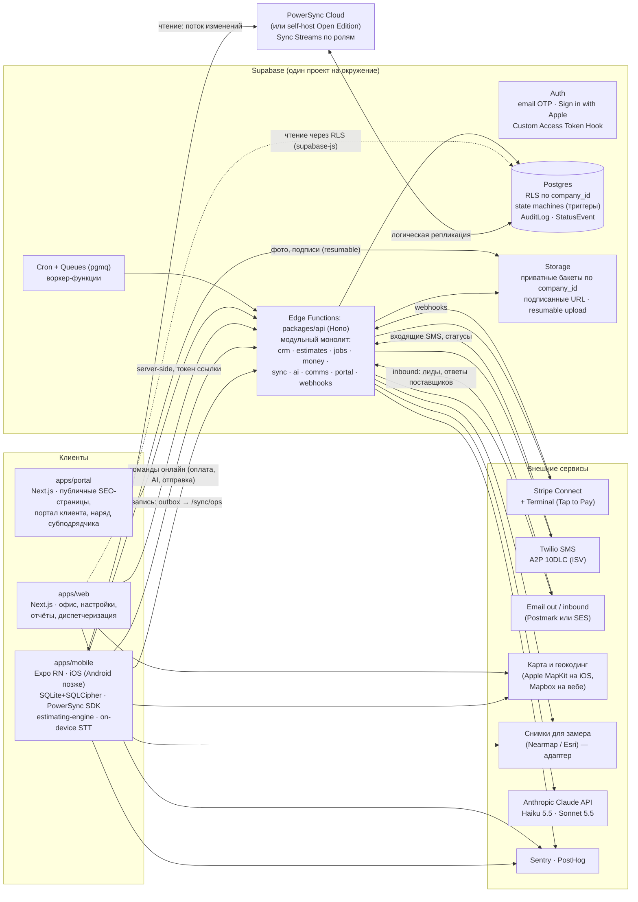
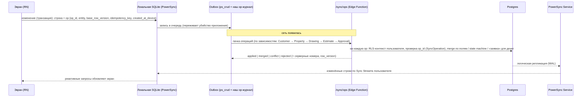

# 06. Архитектура Octo

> Статус: **черновик v0.1, Proposed — нужен ревью основателя и технического ревьюера** (Шлюз 3, `00-roadmap.md`). Дата: 03.11.2026.
> Основа: `02-product-vision.md`, `02a-pricing-and-unit-economics.md`, `04-domain-model.md` v0.2, `09-design-system.md`, PRD `03-prd/06`, `09`, `15`, `16`.
> Решения оформлены как ADR в `adr/` (ADR-001…008). Этот документ — общая картина и связи между ними.
> **Правило документа:** **[Факт]** — проверено по источнику (ссылка и дата проверки в §16); **[Совет]** — наша рекомендация; **[Проверить]** — не удалось подтвердить первоисточником, перепроверить до реализации.

---

## 0. Коротко (TL;DR)

| Область | Совет | ADR |
|---|---|---|
| Стек | **Expo (React Native, New Architecture) + Next.js + Supabase (Postgres, Auth, Storage, Edge Functions, Cron, Queues)**, всё на TypeScript | 001 |
| Репозиторий | Один монорепозиторий (pnpm + Turborepo): `apps/mobile`, `apps/web`, `apps/portal`, `packages/*`, `supabase/` | 002 |
| Серверная логика | **Модульный монолит** `packages/api` (Hono), разворачивается как Supabase Edge Functions; тот же код может переехать на Node-хостинг без переписывания | 001, 002 |
| Офлайн | **PowerSync** (Supabase-интеграция, SQLite + SQLCipher на телефоне, Sync Streams по ролям); запись — через наш endpoint `/sync/ops`, а не напрямую в таблицы | 003 |
| Спутник для замеров | **Google и Mapbox нельзя** для обводки (их условия прямо запрещают). Кандидаты: **Nearmap** (лицензия для замеров) и **Esri World Imagery** (разрешает сбор данных) + всегда «своё фото с калибровкой». Решаем пилотом на 20 объектах и ответом юриста (Б2) | 004 |
| Движок смет | Один детерминированный пакет `packages/estimating-engine`: целые центы, decimal-арифметика, собственный безопасный парсер формул, `engine_version`, общие golden-тесты для телефона и сервера | 005 |
| AI | Свой конвейер на Claude API: Haiku 5.5 (роутер, простое) → детерминированный поиск → Sonnet 5.5 (планировщик смет) → dry-run в доменных сервисах → предпросмотр → подтверждение → отмена; инструменты = whitelist доменных операций | 006 |
| Платежи | Stripe Connect (новые connected accounts через **controller properties / Accounts v2**, а не «тип Express»), direct charges + `application_fee_amount`, идемпотентность, вебхуки ровно один раз; Tap to Pay через `stripe-terminal-react-native` | 007 |
| Дизайн-токены | W3C DTCG JSON → Style Dictionary → CSS-переменные + Tailwind v4 `@theme` (веб, портал) и TS-тема (React Native, PDF) | 008 |

**Блокеры для Фазы 4–5:**
1. ⛔ **Лицензия спутника (Б2/Д1)**: ни Google, ни Mapbox не разрешают обводку снимков для коммерческого замера (§10.4, ADR-004). Нужно: письменное подтверждение Esri и/или договор с Nearmap + ответ юриста. До этого срез 3 строится на «своём фото с калибровкой» и быстром вводе, а слой снимков — заменяемый адаптер.
2. ⚠️ Apple Tap to Pay: entitlement для разработки и **отдельный** для распространения (TestFlight/App Store) — подаём сразу (Д3).
3. ⚠️ Stripe Accounts v2: часть функций ещё помечена preview (по вторичному источнику) — уточнить у Stripe при подключении (ADR-007).

---

## 1. Обзор системы



**Главные принципы (из PRD, превращённые в архитектуру):**
1. **Одна правда — Postgres.** Устройства держат реплику; деньги, номера документов, отправки клиенту и статусы денежных документов решает только сервер (`16` §7).
2. **Одна доменная логика.** Типы, state machines, правила прав и движок смет живут в общих пакетах и используются телефоном, вебом и сервером (§3).
3. **Изоляция компаний в базе**, а не в UI: RLS + проекции (§4).
4. **AI — тот же клиент API, с правами пользователя**; у него нет «своих» путей в базу (§9, ADR-006).
5. **Заменяемые внешние провайдеры** (снимки, email, SMS) через адаптеры в `packages/integrations` — условия и цены у них меняются.

---

## 2. Стек и платформы

| Слой | Выбор | Статус |
|---|---|---|
| iOS (и позже Android) | Expo SDK 55+ (React Native 0.83, только New Architecture), Expo Router, EAS Build / Submit / Update | [Факт] SDK 55 включает RN 0.83 и больше не поддерживает Legacy Architecture (F8). [Совет] брать актуальный SDK на старте Фазы 4 |
| Анимации, жесты, стекло | Reanimated, Gesture Handler, нативный blur (`09-design-system.md`) | [Совет] |
| Веб-приложение и портал | Next.js 16 (App Router, Turbopack по умолчанию, Cache Components), React 19.2, Tailwind v4, shadcn/ui | [Факт] Next.js 16 вышел 21.10.2025 (F9); [Проверить] нет ли 17 к Фазе 4 |
| База и бэкенд | Supabase: Postgres, Auth, Storage, Edge Functions (Deno), Cron, Queues | [Факт] цены Pro — F10; [Проверить] лимиты Edge Functions (CPU/wall time) на дату реализации |
| Синхронизация | PowerSync (ADR-003) | [Факт] F11 |
| Язык | TypeScript везде; SQL-миграции | [Совет] |
| Хостинг веба | Vercel (preview на каждый PR) | [Совет] |
| Ошибки и аналитика | Sentry (RN + Next + Edge), PostHog | [Совет] |

Почему не нативный Swift: одна команда и AI-разработка выигрывают от одного языка и общих пакетов с вебом и сервером; движок смет обязан давать одинаковый результат на телефоне и сервере — проще, когда это один и тот же TS-код (ADR-001, ADR-005).

---

## 3. Монорепозиторий и модули

```
octo/
├─ apps/
│  ├─ mobile/            Expo (iOS; Android позже). Экраны, локальная БД, outbox, офлайн-снимки
│  ├─ web/               Next.js: офис/планшет/десктоп, только для вошедших пользователей
│  └─ portal/            Next.js: витрина (SEO), портал клиента, наряд субподрядчика по ссылке
├─ packages/
│  ├─ design-tokens/     W3C DTCG JSON → CSS vars, Tailwind @theme, TS-тема RN, PDF (ADR-008)
│  ├─ domain/            Типы сущностей (из схемы БД), enum, state machines, матрица прав,
│  │                     правила денег (cents, bps, round half up), валидация (zod)
│  ├─ estimating-engine/ Чистые функции: сборки → строки → итоги; парсер формул; golden-тесты (ADR-005)
│  ├─ gutters/           Геометрия чертежа: длины, углы inside/outside, end caps, cut list (PRD 06 §7)
│  ├─ api-client/        Типизированный клиент API (Hono RPC / OpenAPI), idempotency, retries
│  ├─ api/               Серверный модульный монолит (Hono): модули crm, catalog, estimates, jobs,
│  │                     money, purchasing, comms, portal, ai, sync, webhooks, admin
│  ├─ sync/              Схема локальной БД, описание Sync Streams, outbox-протокол, merge-правила
│  ├─ integrations/      Адаптеры: stripe, twilio, email, maps/geocoding, imagery, claude
│  ├─ ui-web/            Компоненты веба на токенах (одна кнопка — один компонент)
│  ├─ ui-native/         Компоненты RN на токенах
│  ├─ i18n/              EN/ES/RU строки, форматирование ft-in, денег, дат
│  └─ test-fixtures/     Данные основателя (прайс, сметы), golden-кейсы денег (PRD 18)
├─ supabase/
│  ├─ migrations/        SQL: таблицы, RLS, триггеры state machines, функции
│  ├─ tests/             pgTAP: RLS «чужая компания не видна», переходы статусов, идемпотентность
│  ├─ functions/         Тонкие входы Edge Functions → packages/api
│  └─ seed/              Стартовый price book модуля Gutters, тестовые компании
├─ e2e/                  Maestro (iOS-симулятор, управление сетью: офлайн-тесты T1–T12), Playwright (веб)
└─ tooling/              eslint, tsconfig, генерация типов из БД
```

**Модульный монолит** [Совет]: один деплой, внутри — модули с явными границами. Модуль владеет своими таблицами и экспортирует только сервисы (`estimates.approve(...)`), чужие таблицы напрямую не трогает. Межмодульные побочные эффекты (смета одобрена → Job, депозит-инвойс, PO-черновики) идут через **доменные события в outbox-таблице** той же транзакции и обрабатываются воркером идемпотентно. Микросервисы не нужны до десятков тысяч компаний (§14).

Правило зависимостей: `domain` ← `estimating-engine`, `gutters` ← `api`, `mobile`, `web`. Пакеты `domain`/`estimating-engine`/`gutters` **не зависят** от React, Supabase и сети (работают на Hermes, в Deno и Node).

---

## 4. Мульти-тенантность: компании, группы, RLS

### 4.1 Модель доступа
- Каждая бизнес-строка имеет `company_id` (`04` §0). Платформенные сущности (`04` §8a) — в отдельной схеме `platform` с отдельными политиками.
- Доступ определяется **только** таблицей `membership` (`user_id`, `company_id`, `role`, `status = active`, `permissions_override`).
- **Активный контекст** (компания или группа) — custom claim в JWT через Supabase Auth Custom Access Token Hook [Совет; Проверить имя механизма на дату реализации]: `ctx = {kind: company|group, id}`. Claim **сужает** видимость, но не даёт прав: политика всегда проверяет членство.

### 4.2 Политики (схема)
```sql
-- security definer, stable: список компаний, где пользователь активен
create function app.my_company_ids() returns uuid[] ...;
-- компании активного контекста ∩ my_company_ids()
create function app.ctx_company_ids() returns uuid[] ...;
-- роль пользователя в компании
create function app.my_role(company uuid) returns app.role ...;

create policy customer_select on customer for select
  using (company_id = any (app.ctx_company_ids()) and deleted_at is null);
```
- `tech` видит только клиентов/объекты своих визитов: политика через `exists(select 1 from visit_assignment ...)` (индексы обязательны).
- Объединённый вид группы = тот же запрос по `ctx_company_ids()` из нескольких компаний, не общая таблица (`02` §5a).
- Запись: вставка разрешена, только если `company_id ∈ my_company_ids()` и роль позволяет действие; **денежные и статусные изменения идут только через API** (у ролей нет прямого `update` на `invoice`, `payment`, `estimate_version.locked_*`, `status`).

### 4.3 Скрытые поля (себестоимость, цены клиента для субподрядчика)
RLS работает по строкам, а не по колонкам. Поэтому [Совет]:
- **Себестоимость — в соседних таблицах** с отдельной политикой: `estimate_line_cost`, `catalog_item_cost`, `job_cost_snapshot`, `labor_rate`. Tech и sub их просто не получают — ни через API, ни через синхронизацию.
- **Субподрядчик** читает только проекции: `work_order_view` (адрес, окно, доступ в день работ, объём, чертёж, количества BOM — без цен). Сами `invoice`, `estimate_*` для роли `subcontractor` закрыты полностью.
- `gate_code` — шифрование поля (pgsodium/Vault или шифрование в API) и выдача только через функцию с проверкой «назначен на визит сегодня/завтра» (`04` §2, А14).
- Те же правила зашиты в Sync Streams (ADR-003): на устройство не попадает то, что роль не видит.

### 4.4 Обязательные проверки
pgTAP-тесты на каждую таблицу: «пользователь компании B не видит и не меняет строки A» (в т.ч. через Storage и через `/sync/ops`), «tech не видит cost-таблицы», «sub не видит цен». Это часть Definition of Done (`00-roadmap.md` п. 8). Сервисный ключ (`service_role`) есть только у API и воркеров, никогда в приложениях.

---

## 5. Данные: схема, идентификаторы, аудит
- UUID v7 создаётся на устройстве (`04` §0). Человеческие номера — счётчики в `company_numbering` с `select … for update` в транзакции API.
- **State machines** — в двух местах из одного описания: таблица разрешённых переходов в `packages/domain` (UI, AI, тесты) и генерируемая из неё SQL-функция-триггер `assert_transition()` (последняя линия защиты). Каждый переход → `status_event`.
- Отправленная версия сметы неизменяема: триггер запрещает `update` при `locked_at is not null`; `content_hash` = SHA-256 канонического JSON (`05`).
- `audit_log` пишется из API (с `actor_type`, `on_behalf_of_user_id` для AI) и из триггеров для прямых изменений; хранится append-only (политика без `update/delete`).
- Деньги — `bigint` центы, проценты — `int` bps, длины — `numeric(10,3)` (`04` §0). В TS — `number` только для центов в безопасном диапазоне; промежуточная арифметика — decimal (ADR-005).
- Поиск: `pg_trgm` по именам/адресам, `match_key` для дублей, полнотекст позже. Дневные агрегаты отчётов (`14`) — материализованные таблицы, пересчитываемые воркером по событиям (Д5).

---

## 6. Офлайн-синхронизация: поток данных



- **Чтение** — PowerSync держит частичную реплику по Sync Streams: визиты −7…+14 дней, связанные клиенты/объекты, каталог и сборки целиком, черновики смет и т.д. (`16` §7). Стримы параметризуются ролью и компаниями пользователя.
- **Запись** — PowerSync даёт локальную очередь (`uploadData`); мы **не** пишем из неё напрямую в таблицы через PostgREST, а отправляем пачкой в `/sync/ops`, где живут: идемпотентность по `op_id` (`sync_operation`), слияние по полям с `base_row_version` (храним версии полей `field_versions jsonb` у черновиков и простых записей), правила классов данных из `16` §7 (деньги — заявки, статусы — по state machine в порядке `created_at_device`, append-only — всегда принимаются), создание `sync_conflict` и Task владельцу.
- **Файлы** — отдельная очередь на устройстве, resumable-загрузка в Storage; запись `file` с `upload_status` приходит раньше самого файла.
- **Движок смет на телефоне** считает так же, как сервер; сервер при приёме пересчитывает и сравнивает (`calc_hash`). Расхождение → версия помечается, клиенту не уходит (ADR-005).
- **Безопасность устройства** — SQLCipher (ключ в Keychain), раздельный кэш по компаниям, удалённое стирание по `device.revoked_at` / `membership.suspended_at` (`16` §7, OFF-US-10).
- **Версии схемы** — API принимает операции от приложений ≥ 2 версий назад (`16` §11); изменения схемы только «расширение → миграция данных → сужение».

---

## 7. Файлы и медиа
| Бакет | Что | Доступ |
|---|---|---|
| `company-private` | фото работ, чеки, подписи, COI/W-9, PDF смет/инвойсов/нарядов, исходные письма | RLS на `storage.objects` по первому сегменту пути `company_id/…` + роль; выдача — подписанные URL с коротким сроком |
| `company-public` | галерея витрины (`File.public_gallery = true`), логотипы | публичное чтение, запись только API |
| `imagery-cache` | снимки для чертежей — **только если лицензия провайдера разрешает хранение** (ADR-004) | как `company-private` |
| `exports` | `DataExport` | подписанный URL, 7 дней |

- Миниатюры генерируются при загрузке (воркер) или трансформациями Supabase [Проверить: тариф и лимиты]. Оригиналы фото — до 4–6 МП после сжатия на устройстве.
- Подписи и подписанные PDF хранятся 7 лет (Б8); у бакета — запрет удаления для этих `kind` (политика + `deleted_at` вместо удаления).
- EXIF-геометки фото снимаются для клиентских ссылок и витрины.

---

## 8. Фоновые задачи
**Механика** [Совет]: Supabase Cron (pg_cron) ставит задания, Supabase Queues (pgmq) хранит очередь, воркер — Edge Function, которая читает пачку, обрабатывает идемпотентно и подтверждает. Повторы с экспоненциальной задержкой, «мёртвая» очередь с алертом. [Проверить] лимиты Queues/Cron на дату реализации; запасной вариант — `graphile-worker` на Node-хостинге.

| Задача | Когда | Идемпотентность |
|---|---|---|
| Генерация повторяющихся визитов (`RecurringPlan.rrule`, `generate_ahead_days`) | ежедневно 03:00 по `Company.timezone` + при изменении плана | unique(`recurring_plan_id`, `occurrence_date`) |
| Напоминания и цепочки (`ScheduledMessage`: визиты, дожим смет, инвойсы, отзывы) | каждые 5 мин | unique(`automation_key`, `subject_id`, `step`); quiet hours; проверка согласия SMS на момент отправки |
| Входящие письма: лиды маркетплейсов | по вебхуку inbound | `Lead.inbound_message_id` |
| Входящие письма: ответы поставщиков на RFQ | по вебхуку inbound | `rfq_token` в адресе reply-to + `message_id` |
| Доменные события (смета одобрена → Job, депозит, PO) | сразу (outbox-событие) | уникальные индексы (`job.estimate_id`) |
| Stripe / Twilio вебхуки | сразу, обработка асинхронно | `webhook_event.event_id` unique |
| OCR чеков, скан прайсов и ценников (MVP), импорт файлов (`ImportJob`), AI-черновики поддержки | очередь; ценник и прайс ≤ 20 стр. — синхронный вызов, Batch API — только по выбору для больших файлов | `ai_action.idempotency_key`, `import_job.id` |
| Истекающие COI/лицензии, просрочка инвойсов, истечение смет | ежедневно | флаг «уведомлено» на дату |
| Агрегаты отчётов и ROI | по событиям + ночной пересчёт | детерминированный пересчёт периода |
| `DataExport`, очистка TTL (`UserLocation` 30 дней, истёкшие ссылки) | ночью | — |

**Разбор входящей почты (лиды и RFQ)** — граница доверия:
1. Inbound-вебхук провайдера → проверка подписи → сырое письмо в `company-private` (`raw_file_id`), запись в очередь. Адрес определяет компанию (`leads-<slug>@in.octo.app`, `rfq-<token>@in.octo.app`); для RFQ — отправитель из `Supplier.verified_emails`.
2. **Сначала детерминированный разбор** по шаблонам `LeadSource.sender_patterns` (Thumbtack, Yelp, LSA — на письмах основателя, Г3).
3. Не распознано → Haiku с **структурированным выводом по схеме**, письмо — только как данные в отдельном блоке, без инструментов (ADR-006). Числа (цены поставщика) проверяются детерминированно.
4. Результат — `Lead(parse_status)` / `SupplierQuote(needs_review)`; **применение цен — только кнопкой человека** (PRD 11).

---

## 9. AI-помощник (кратко; подробно — ADR-006 и будущий `07-ai-assistant.md`)
- Модуль `api/ai` — конвейер из `15` §7.1: устройство (словарь навигации, $0) → Router (Haiku 5.5, structured output) → проверка роли/лимита → детерминированный поиск сущностей → Planner (Sonnet 5.5 для `estimate.*`, Haiku для остального) с **инструментами = операции whitelist'а intent'а** → dry-run через доменные сервисы и движок → `AiAction(proposed)` с diff → подтверждение → apply в транзакции → `undo_payload`.
- Модель **никогда** не пишет в базу: она возвращает план, его исполняют те же сервисы, что и UI, с JWT пользователя.
- Учёт: `tokens_in/out`, `cost_cents`, `model` в каждом `AiAction`; лимиты из `Entitlement` (`02a` §6).

---

## 10. Интеграции

### 10.1 Stripe (подробно — ADR-007)
- Connect: аккаунт на каждую `Company`; онбординг — hosted от Stripe; direct charges на аккаунт подрядчика + `application_fee_amount` (наша прозрачная надбавка).
- [Факт] Stripe рекомендует для новых платформ controller properties вместо типов Standard/Express/Custom; direct charges на legacy Express/Custom аккаунтах тарифицируются connected-аккаунту по стандартным ставкам (F14).
- Ключи идемпотентности = `PaymentAttempt.idempotency_key`; источник правды — вебхуки (`webhook_event`).
- Tap to Pay: `stripe-terminal-react-native` + Expo config plugin; нужен Apple entitlement для разработки и отдельный для распространения (F14).
- Подписка Octo — Stripe Billing на сайте (ADR-007 §подписка).

### 10.2 Twilio (SMS)
- ISV-модель: бренд и кампания A2P 10DLC на каждую компанию; номер на компанию (Pro / пакет). [Факт] регистрация бренда sole proprietor — $4.50 разово (после повышения TCR 01.08.2025); sole proprietor — только без EIN (F16). Стандартный бренд — дороже, [Проверить] по прайсу Twilio.
- Входящие SMS и STOP → вебхук → `Message`, `Contact.sms_opted_out_at` (блок на сервере). Отправка проверяет согласие и quiet hours **в момент отправки**.
- До ответа юриста (Б3) автоматизации идут по email.

### 10.3 Email
- [Совет] **Postmark** для транзакционных писем и inbound (JSON-вебхук с разобранным письмом); Amazon SES — для массовых сезонных кампаний позже (дешевле, `02a`). Обе — за адаптером. [Проверить] текущие цены и условия inbound.
- Домен отправки — общий `mail.octo.app` с `reply-to` компании (MVP); собственный домен компании (DKIM) — позже.

### 10.4 Карты, геокодинг и снимки для замера (подробно — ADR-004)
Три разные задачи с разными лицензиями:

| Задача | Совет | Почему |
|---|---|---|
| **Карта** (диспетчеризация, слои, маршруты) | iOS: Apple MapKit через `react-native-maps` (провайдер по умолчанию на iOS). Веб: Mapbox GL JS | Только показ, без извлечения данных. [Проверить] условия MapKit JS/Server API для веба и лимиты |
| **Геокодинг** с постоянным хранением `Property.geo` | Mapbox Geocoding в режиме **Permanent** | [Факт] Mapbox Product Terms §2.7.3 разрешают постоянно хранить Permanent Geocodes; временные — нельзя (§2.7.2) (F3). У Google координаты из ряда API можно кэшировать только 30 дней (F2) |
| **Снимок для обводки гаттеров** | **Nearmap** (лицензия на измерения, 5–7.5 см) или **Esri World Imagery** (разрешён сбор данных) + «своё фото с калибровкой» всегда | [Факт] Google ToS §3.2.3(c) прямо запрещает «trace or digitize … building outlines … from Satellite»; Mapbox Product Terms §1.6 запрещают трассировку кроме некоммерческой и OpenStreetMap (F1, F3) |

**Архитектурное следствие (важно):** чертёж хранит геометрию в **географических координатах** (lat/lng вершин, плюс локальная проекция в футах), а не только в пикселях снимка. Тогда снимок — заменяемая «подложка»: можно сменить провайдера, перезапросить снимок, не хранить его, если лицензия не разрешает, и при этом чертёж, длины и смета остаются. Поле `Drawing.base_image` становится необязательным (обязательно только для `upload`). Это изменение модели данных — в `04` v0.3 (ADR-004).

### 10.5 Claude API
- Прямой Anthropic API (не через посредников), SDK `@anthropic-ai/sdk` на сервере; ключ — только в секретах Edge Functions.
- [Факт] Sonnet 5.5: $2 / $10 за 1M (кэш-чтение $0.20); Haiku 5.5: $0.10 / $0.50 за 1M (до 100K токенов в запросе); Batch API −50%. На Sonnet 5.5 принудительный `tool_choice` (`any`/`tool`) не поддерживается — используем `auto` + `strict: true` и structured outputs (F17).
- Prompt caching: стабильный префикс (system → схемы инструментов → сводка каталога компании), изменчивые данные — после.

---

## 11. Окружения
| Окружение | Supabase | Веб | Мобильное | Данные |
|---|---|---|---|---|
| `local` | Supabase CLI (Docker) | `next dev` | Expo dev client | seed + фикстуры |
| `preview` | Supabase Branching на PR [Совет: включаем, если укладывается в бюджет; ветки тарифицируются почасово вне spend cap — F10] | Vercel preview | EAS Update канал `preview` | seed |
| `staging` | отдельный проект Pro | `staging.octo.app` | TestFlight (внутренние) | синтетика + копия данных основателя без PII |
| `prod` | отдельный проект Pro (+ PITR позже) | `app.octo.app`, `octo.app` (портал) | App Store / TestFlight | реальные |

- Отдельные Stripe (test/live), Twilio (тестовые номера/субаккаунты), PowerSync-инстансы, ключи Claude (разные workspace с лимитами расходов) на staging и prod.
- Секреты: Supabase secrets (Edge Functions), Vercel env, EAS secrets; в репозитории — только `.env.example`. Ротация ключей — по runbook (в `08-security.md`).

## 12. CI/CD
- **GitHub Actions** на каждый PR: typecheck, lint, unit-тесты (Vitest) всех пакетов, **golden-тесты движка смет и денег** (`18-money-test-cases.md`) — в Node и в Hermes (через тест-сборку или Maestro), pgTAP (RLS, переходы, идемпотентность) на локальном Supabase в CI, red-team тесты AI на записанных ответах (без живой модели), Playwright для веба.
- **Миграции**: только через файлы `supabase/migrations`; merge в `main` → автоприменение на staging; prod — ручное подтверждение (GitHub Environment с approval). Обратная совместимость с приложениями в сторах обязательна (§6).
- **Мобильное**: EAS Build на тег; EAS Update для JS-исправлений с runtime-версией, привязанной к схеме локальной БД (обновление, меняющее схему, — только через стор).
- **Ночной прогон**: Maestro офлайн-сценарии T1–T12 на симуляторе с управлением сетью (`16` §11).

## 13. Наблюдаемость, бэкапы, эксплуатация
- **Ошибки**: Sentry (RN с source maps из EAS, Next, Edge Functions) с тегами `company_id` (хэш), `app_version`, `sync_state`.
- **Продуктовая аналитика**: PostHog (события без PII; клиенты подрядчиков не трекаются).
- **Метрики бизнеса и себестоимости**: таблица `usage_counter` + ежемесячный отчёт себестоимости по компании (AI, SMS, email, снимки) — `02a` §6 п. 6.
- **Алерты**: ошибки вебхуков Stripe, рост «мёртвой» очереди, доля `rejected` в `/sync/ops`, отставание PowerSync-репликации, стоимость AI в сутки > порога.
- **Бэкапы** [Совет]: ежедневные бэкапы Supabase Pro + **еженедельный логический дамп** (`pg_dump`) и копия бакетов Storage в независимое хранилище (другой облачный аккаунт), шифрование, проверка восстановления раз в квартал. PITR включаем при первых платящих клиентах. [Проверить] срок хранения бэкапов на Pro.
- **Экспорт данных клиентом** (честная цена, `02` §2) — тот же механизм `DataExport`.

## 14. Стоимость и пределы масштаба

**Стоимость инфраструктуры (оценка, $/мес)** [Совет на основе F10, F11; Проверить перед запуском]:

| Статья | 0–20 компаний (бета) | ~200 компаний | ~2,000 компаний |
|---|---|---|---|
| Supabase prod (Pro + compute) | 25–60 | 100–250 | 400–1,000 |
| Supabase staging | 25–35 | 25–35 | 35–60 |
| PowerSync | 0–49 (Free → Pro) | 49–100 | Team 599+ или self-host |
| Vercel | 0–20 | 20–50 | 50–200 |
| Sentry + PostHog | 0–50 | 50–150 | 150–400 |
| Email (Postmark/SES) | 15 | 15–50 | 50–150 |
| Снимки для замера | зависит от ADR-004 (Nearmap — договор; Esri — по запросам тайлов) | | |
| AI, SMS | переменные, покрываются тарифом и пакетами (`02a`) | | |

**Пределы и что делать** [Совет]:
| Предел | Когда упрёмся | Действие |
|---|---|---|
| PowerSync Pro: 1,000 одновременных клиентов (до 3,000 с доплатой $30/1,000) (F11) | ~1,000+ активных компаний в пик сезона | Team-план или self-host Open Edition |
| Один Postgres | десятки тысяч компаний, тяжёлые отчёты | read replica для отчётов, агрегаты, партиционирование `audit_log`/`activity`/`message` по времени |
| Edge Functions (время выполнения) | тяжёлые PDF, экспорт, пачки AI | вынести воркеры на Node-хостинг (тот же код `packages/api`) |
| RLS-производительность | сложные политики tech/sub | индексы под политики, `security definer` функции со `stable`, проверка `EXPLAIN` в CI на больших фикстурах (T10: 5,000 клиентов) |
| Storage | фото 7 лет | сжатие на устройстве, lifecycle на холодное хранение |

## 15. Что дальше (артефакты Фазы 3)
1. Ревью ADR-001…008 (основатель + технический ревьюер), статус → Accepted.
2. `04-domain-model` v0.3: геометрия чертежа в гео-координатах, cost-таблицы отдельно, `field_versions`, `company_numbering`, `domain_event` (из этого документа).
3. Схема БД и RLS (3.2), `07-ai-assistant.md` (3.4), `08-security.md` (3.5), `08a-seo.md` (3.6).
4. Пилот снимков: 20 объектов основателя, Nearmap trial vs Esri vs рулетка (ADR-004).
5. Заявки: Apple Tap to Pay entitlement, Nearmap/Esri коммерческие условия, Twilio ISV.

---

## 16. Источники фактов (проверено 03.11.2026)
| # | Факт | Источник |
|---|---|---|
| F1 | Google Maps Platform ToS §3.2.3: (a) No Scraping — запрет «pre-fetch, index, store … outside the services», (b) No Caching — кроме разрешённого в Service Specific Terms, (c) No Creating Content — пример (i) «trace or digitize roadways, building outlines … from the Maps JavaScript API Satellite base map type». Текущая редакция от 26.08.2026 | https://cloud.google.com/maps-platform/terms |
| F2 | Google Maps Service Specific Terms (ред. 28.10.2026): §20 Solar API — только для энергосистем (solar), кэш до 30 дней; кэш координат ряда API — до 30 дней | https://cloud.google.com/maps-platform/terms/maps-service-terms |
| F3 | Mapbox Product Terms (Last Updated 20.10.2026): §1.6 No Tracing — трассировка спутника разрешена только «(i) for non-commercial purposes or (ii) for OpenStreetMap»; §1.9 — по умолчанию нельзя «export, download, cache or store Licensed Map Content»; §2.8.1 — кэш на устройстве до 30 дней в пределах лимитов SDK, без скриншотов; §2.7.2–2.7.3 — Temporary geocodes нельзя хранить, Permanent — можно | https://www.mapbox.com/legal/product-terms (PDF «Mapbox Product Terms (October 20, 2026)») |
| F4 | Esri World Imagery: «This layer may be used in various ArcGIS apps to support data collection and editing», результаты можно использовать внутренне или делиться; для офлайна — отдельный слой «World Imagery (for Export)»; лицензия — Esri Master License Agreement | https://www.arcgis.com/home/item.html?id=10df2279f9684e4a9f6a7f08febac2a9 |
| F5 | Nearmap: стандартное соглашение запрещает pre-fetch/cache/store, если явно не разрешено; интеграция только способами, разрешёнными Nearmap. Прецедент: RoofLink даёт подрядчику ввести свой Nearmap API key или купить кредиты через RoofLink | публичная копия Nearmap Products Agreement (Yellowstone County, 2026); https://intercom.help/rooflink/en/articles/5807617-nearmap-overview |
| F6 | LARIAC7 (LA County): орто 10 см, поставка 02.2024; данные под лицензией консорциума, не public domain | https://lariac-lacounty.hub.arcgis.com ; LARIAC7 Program Overview 2023 |
| F7 | Apple MapKit: официальный текст Attachment 6 о кэшировании/извлечении не найден; инженер Apple DTS отказался толковать условия и советует юриста | https://developer.apple.com/forums/thread/721163 |
| F8 | Expo SDK 55: React Native 0.83, React 19.2; Legacy Architecture не поддерживается, `newArchEnabled` удалён | https://expo.dev/changelog/sdk-55 |
| F9 | Next.js 16 (21.10.2025): Turbopack стабилен и по умолчанию, Cache Components (`use cache`), React Compiler стабилен | https://nextjs.org/blog/next-16 |
| F10 | Supabase Pro: $25/мес, 100k MAU (далее $0.00325/MAU), 8 GB БД, 250 GB egress, $10 compute credits; preview-ветки тарифицируются почасово и вне spend cap | https://supabase.com/pricing ; вторичные обзоры 2026 (schematichq, jetadmin) — **перепроверить на официальной странице** |
| F11 | PowerSync: Free; Pro от $49 (30 GB sync, 10 GB hosted, 1,000 peak clients, доплата $30/1,000 до 3,000); Team от $599; self-hosted Open Edition бесплатно; Sync Streams — рекомендуемый способ (Sync Rules — legacy); SQLCipher в RN через `@powersync/op-sqlite` | https://powersync.com/pricing.md ; https://docs.powersync.com/sync/overview ; https://docs.powersync.com/client-sdks/advanced/data-encryption |
| F12 | ElectricSQL: синхронизация только чтения, записи — через свой API; TanStack DB 0.6 (25.03.2026) с SQLite-персистентностью для RN | https://electric-sql.com/blog/2026/03/25/tanstack-db-0.6-app-ready-with-persistence-and-includes |
| F13 | Zero 1.0 (июнь 2026) стабилен, поддерживает RN/Expo, **но «Zero does not support offline writes»** | https://zero.rocicorp.dev/docs/release-notes/1.0 ; https://zero.rocicorp.dev/docs/offline |
| F14 | Stripe: для новых connected accounts рекомендуются controller properties (Accounts v2), типы — legacy; direct charges на legacy Express/Custom — по стандартным ставкам аккаунту. Tap to Pay: нужен entitlement разработки и отдельный для распространения; Expo config plugin; описаны проблемы provisioning в EAS | https://docs.stripe.com/connect/accounts ; https://docs.stripe.com/terminal/payments/setup-reader/tap-to-pay?platform=ios ; https://developer.apple.com/forums/thread/795780 |
| F15 | App Store (США): с 04.2025 Apple не берёт комиссию за внешние ссылки на оплату; 9-й округ (12.2025) оставил контемпт, но разрешил обсуждать комиссию; Верховный суд 30.06.2026 принял апелляцию (№ 25-1311); 14.08.2026 Apple предложила 15% / 5% (Small Business) | https://thenextweb.com/news/supreme-court-apple-epic-contempt-app-store-commission ; https://www.iphoneincanada.ca/2026/08/14/apple-proposes-15-cut-purchases-outside-app-store/ |
| F16 | Twilio A2P 10DLC: бренд sole proprietor $4.50 разово (после 01.08.2025), только без EIN, 1 кампания, 1 номер, 1 MPS | https://support.twilio.com/hc/en-us/articles/4407882914971 |
| F17 | Claude: Sonnet 5.5 $2/$10 (кэш $0.20), Haiku 5.5 $0.10/$0.50 (≤100K), Batch −50%; на Sonnet 5.5/Opus 5.5 `tool_choice: any/tool` → 400; structured outputs через `output_config.format`, `strict: true` у инструментов | Anthropic Claude API reference (кэш от 06.10.2026); https://platform.claude.com/docs |

**Не проверено в этой сессии** (взято из общих знаний, перепроверить): WatermelonDB, Triplit и Legend-State (статус и поддержка), лимиты Supabase Edge Functions / Cron / Queues, цены Postmark, RevenueCat, Nearmap (цены только по запросу), условия Apple MapKit JS для веба, Esri ArcGIS Location Platform для коммерческого SaaS.
