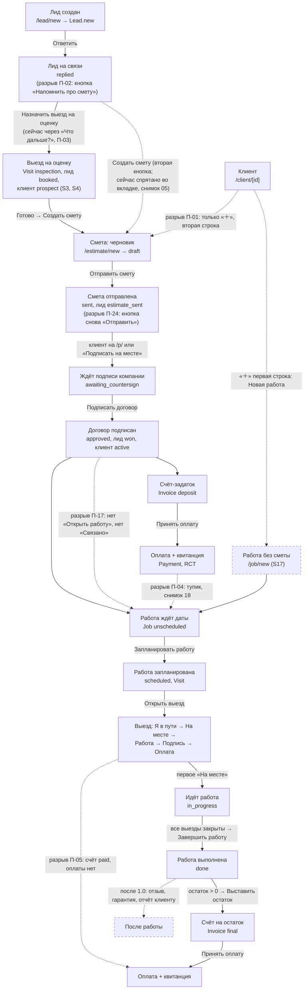

# Главный путь: от лида до оплаты — целевое поведение и план правок (черновик, 11.11.2026, ред. 2 по ревью)

> Чат аудита, поручение основателя от 11.11.2026: «продумать весь путь — где какой экран, что после чего». Это **не проект с нуля**. Путь уже описан в `docs/15-story-map.md` (§3–§5), `docs/13-core-workflow-spec.md`, `docs/specs/15-flows.md` §1.1, §1.2, §1.4, §1.15, спеках 07, 17, 18, 23 и в `design/naryad-ds/DESIGN-SYSTEM.md` §12. Здесь записано только то, где код и живой проход расходятся с описанием, или где описания нет. И план правок.
>
> Источники «как сейчас»: три отчёта аудита пути от 11.11.2026 (код `main` на `104cc95`):
> - **[A]** — экраны и переходы по коду (`docs/audit/2026-11-11-main-path/A-flow.md`, разрывы R-01…R-23);
> - **[C]** — счета, оплаты, PDF, работа (`docs/audit/2026-11-11-main-path/C-money-pdf-job.md`, пункты 1.1…5.8);
> - **[B]** — живой проход в демо, 390, тёмная тема (`docs/audit/2026-11-11-main-path/B-live.md`; снимки в репозиторий не положены, лежат у чата аудита: `live/01…41`, `live/A/A01…A42`).
>
> Пути к коду указаны от `apps/mobile/src/`. Номера строк перепроверены по `104cc95` при второй редакции. ID находок прошлого аудита (A, B, Q, S, L, T, X) — из `docs/audit/2026-11-11-full-audit.md`; номера строк в аудите местами старые (помечено). Номера задач (#) — открытые Issues на 11.11.2026.
> Правило 22 действует: всё, что добавляет новую функцию ядра, помечено «после 1.0». Где пункт оставлен до 1.0, рядом одно предложение, почему это починка пути, а не новая функция.
> Принципы чата аудита — **П1…П10**. Разрывы пути в §4 — **П-01…П-45**. Решения по возражениям автора — §3.8.

---

## 0. Вывод для основателя (полстраницы)

**Что не так.** Сам путь в приложении есть целиком: лид → смета → подпись → задаток → работа → выезд → оплата → закрытие. Его можно пройти от начала до конца ([B] §2, 29 шагов, ошибок нет). Плохо другое: на каждом шаге **непонятно, что нажать дальше**, и в одном месте **не сходятся деньги**.
1. Ваша жалоба повторена. На клиенте нет кнопки «Создать смету». Жёлтый «＋» показывает две строки, и первая — «Новая работа». Вы попали в форму работы: там «Тип работы» и «Создать работу», а позиций нет ([B] снимки A03–A05).
2. Деньги. Оплата на выезде отмечает счёт оплаченным, но **сама оплата и квитанция не записываются**. У клиента написано «Оплатил $51», хотя он заплатил $510 ([B] снимки 34, 39). Задача #1103.
3. Тупики. Задаток оплачен — на экране нет кнопки «что дальше». Работа закрыта — дальше тоже ничего. Смета отправлена — главная кнопка снова «Отправить» ([B] снимки 11, 18, 36).
4. Одно действие называется по-разному. Смету «составляют», «создают» и «делают» — пять разных надписей. Для остатка — две разные кнопки. «В пути» и «Я в пути» — разные действия ([A] R-08, R-15, R-16).
5. Лид после ответа показывает одну кнопку «Напомнить про смету», хотя сметы ещё нет. Через несколько дней она становится жёлтой ([B] снимок 04).
6. Подписанный договор **не хранится в неизменном виде**. Документ каждый раз собирается заново из текущих данных компании. Поменяли адрес компании — поменялся и старый договор. Задача #1105.

**Что меняем (до 1.0).**
- У каждой карточки одна жёлтая кнопка внизу — следующий шаг пути, «глагол + что» (таблица §2.1).
- «＋» только создаёт новое, в порядке пути. «Создать смету» стоит выше «Работа без сметы» (таблица §2.2).
- Любые полученные деньги — это запись оплаты и квитанция. «Оплачено» считается только по записанным оплатам.
- Телефон не даёт выставить счетов больше суммы договора. Пример: договор $10,000, задаток $1,000 выставлен — второй счёт можно выставить не больше чем на $9,000. Позже то же самое проверит и сервер — после вашего ответа на вопрос 6.
- Подписанный договор сохраняется копией в момент подписи: шапка компании, строки, подписи и проверочный отпечаток документа (по нему видно, что текст не меняли). Документ — на обычном американском листе (Letter), одним шрифтом на всех телефонах.
- «Назад» ведёт туда, откуда пришли. Блок «Связано» есть на каждой карточке.
- Мастер на выезде может принять часть суммы, а не только всю.

**Что не меняем.** Порядок шагов и статусы (`docs/15-story-map.md` §5). Как создаются работа и задаток (при подписи обеими сторонами). Расчёт денег. Модуль Gutters (у него своя дорожка). Новых видов записей до 1.0 нет.

**После 1.0.** График платежей на N частей, отчёт клиенту после выезда, гарантия и отзыв, ссылка на страницу счёта, письма от платформы, онлайн-оплата картой (Stripe). Кнопку, которая прячет онлайн-оплату из настроек до 1.1, делаем **до** 1.0 (#842). Новые кнопки конструктора сметы из ваших задач #1096–#1100 — после 1.0, как вы и пометили.

**От вас нужно** — шесть ответов (§6). У каждого есть вариант по умолчанию, работа не стоит.

---

## 1. Путь одной схемой

### 1.1. Схема

Сплошная стрелка — переход есть и виден. Пунктир с пометкой **разрыв** — перехода нет, он спрятан или ведёт не туда. Номера — разрывы из §4.



### 1.2. Таблица шагов: как есть и как должно быть

**Роли:** Вл — владелец (director), Оф — офис (dispatcher), Пр — продажи (sales), М — мастер (tech), К — клиент.
Пометка **расх.** — поведение расходится с целевым.

| # | Шаг | Экран (маршрут) | Кто | Главная кнопка: как есть | Главная кнопка: как должно | Что создаётся / статус | Дальше |
|---|---|---|---|---|---|---|---|
| 1 | Лид создан | `/lead/new` → `/lead/[id]` | все | «Сохранить лид», затем «Ответить» ([B] 01, 02) | так же | `Lead.new` (S1) | 2 |
| 2 | Первый ответ | `/lead/[id]`, шторка ответа | все (М — свои) | **расх.** после исходящего сообщения ход лида — `wait` (`features/leads.ts:181-190`); единственная кнопка «Напомнить про смету» (`lead.remind`, `ru.ts:1297`), вторичная; жёлтой становится через `remindDays` (`action: "remind"`, `leads.ts:190`); сметы при этом нет, текст SMS берёт пустое название сметы (`LeadCard.tsx:77-79,89`; [B] 04) | «Назначить выезд на оценку»; вторая — «Создать смету» | `new → replied` (S2) | 3 или 5 |
| 3 | Выезд на оценку | шторка на лиде → План | Вл, Оф | **расх.** кнопки на лиде нет, путь «Позвонить → Да → Что дальше?» (Q-02, #830) | «Назначить выезд на оценку» — главная на лиде `replied` | `Visit(inspection)`, лид `booked`, клиент `prospect` (S3, S4) | 4 |
| 4 | Осмотр | `/visit/[id]` | М | шаги, затем «Сделать смету» (`job3.makeEstimate`, `app/visit/[id].tsx:301`) | шаги, затем «Создать смету» (П4) | визит `done` (S10) | 5 |
| 5 | Смета | `/estimate/new` | Вл, Оф, Пр; М — с выезда | **расх.** с клиента — только «＋», вторая строка «Смета» ([B] A03; `nav/sections.ts:249`); клиент из лида создаётся молча при открытии ([B] 06; `store.tsx:1095-1117`) | главная «Создать смету» на клиенте и лиде; клиент-потенциальный — при первом сохранении, с тостом и «Вернуть» | `Estimate.draft` (S5) | 6 |
| 6 | Отправка | `/estimate/[id]` → шторка | Вл, Оф, Пр | «Отправить клиенту»; **расх.** статус «отправлена» ставится нажатием SMS/письма, до реальной отправки ([C] 3.4); после этого кнопка та же, шторка не закрывается ([B] 10, 11) | черновик: «Отправить смету»; после возврата из SMS — вопрос «Сообщение ушло?»; после отправки — «Подписать на месте», вторая «Отправить ещё раз» | `draft → sent`, лид `estimate_sent` (S6) | 7 |
| 7 | Подпись клиента | `/p/<token>` или блок на смете | К | **расх.** блок подписи внизу страницы, без подсказки ([B] 12) | «Подписать на месте» в панели открывает подпись | `sent → awaiting_countersign` (S8) | 8 |
| 8 | Подпись компании | `/estimate/[id]` | право `canSignContracts` | «Подписать договор» ([B] 13) | так же; в этот момент сохраняется копия документа (§3.4) | `approved`; лид `won`; клиент `active`; работа `unscheduled`; счёт-задаток (S8b) | 9, 11 |
| 9 | Счёт-задаток | создаётся сам | система | **расх.** название «Deposit» по-английски; статус сразу «отправлен» ([B] 14; `features/estimateSign.ts:107`) | название на языке клиента; «выставлен», а не «отправлен», пока не отправили (Q-13) | `Invoice(deposit)` | 10 |
| 10 | Оплата задатка | `/invoice/[id]` → «Принять оплату» | Вл, Оф, Пр | «Записать $N», частями — работает ([B] 16, 17); **расх.** после полной оплаты тупик ([B] 18) | «Принять оплату»; после полной оплаты — «Запланировать работу» или «Открыть работу» | `Payment`, квитанция; счёт `paid` (S12) | 11 |
| 11 | Планирование | `/job/schedule?jobId=` | Вл, Оф | «Запланировать»; **расх.** форма не закрывается ([B] 22; Q-18) | после сохранения — возврат на работу | `Visit`; работа `scheduled` (S9) | 12 |
| 12 | Выезд | `/visit/[id]` | М | шаги ([B] 25–33); **расх.** оплата только целиком ([B] 33) и без записи оплаты ([B] 34, 39) | шаги; «Принять оплату» с полем суммы, создаёт оплату и квитанцию | шаги визита; работа `in_progress` (S10); `Payment` (S12) | 13 |
| 13 | Закрытие работы | `/job/[id]` | Вл, Оф | «Да, выполнена» ([B] 35, 36) | «Завершить работу»; после закрытия — «Выставить остаток» при остатке > 0 | `done` (S10) | 14 |
| 14 | Счёт на остаток | `/job/[id]` → «Деньги» | Вл, Оф | **расх.** две кнопки: «Выставить остаток» (`inv.billBalance`, `ru.ts:987`) и «Создать счёт на остаток» (`job3.done.invoiceRest`, `ru.ts:1987`) ([A] R-08) | одна «Выставить остаток» | `Invoice(final)` (S11) | 10 |
| 15 | Отчёт | `/reports` | Вл, Оф | бизнес-отчёты ([B] 41) | так же; отчёта клиенту до 1.0 нет, обещание «Отчёт уйдёт клиенту» убрать ([B] 34) | — (S14) | — |

---

## 2. Таблицы П1 и П2

### 2.1. П1 — одна главная кнопка на карточке

**Правило.** У каждой карточки объекта одна видимая главная кнопка (`primary`) в закреплённой панели (DESIGN-SYSTEM §12.3, §7.3). Это следующий шаг пути, «глагол + объект» (словарь §3). Вторая кнопка — `secondary`, слева от главной, не больше одной. Остальное — в «⋯». Если у роли нет права на шаг, кнопки нет совсем: шаг виден текстом в блоке «Что сейчас и что дальше» с указанием, кто его делает (§12.3, #916). Главная кнопка может вести на **другой** объект, если следующий шаг пути там (решение §3.8 п.2).

Сейчас главное действие стоит в шести разных местах (S-08, #879). Кнопки внизу и в шапке секций спорят ([B] 14: «Запланировать работу» и «Выставить остаток $459»).

Пометка **(→ др.)** — намеренно: кнопка ведёт к следующему шагу на другом объекте, поэтому одна и та же кнопка встречается на двух карточках.

| Объект | Статус и условие | Роль с правом | Главная → куда ведёт | Вторая | Роль без права: текст |
|---|---|---|---|---|---|
| Лид | `new`, ход «ответить» | все (М — свои) | Ответить → шторка ответа | Назначить выезд на оценку | — |
| Лид | `replied`, нет осмотра и сметы | Вл, Оф, Пр | Назначить выезд на оценку → шторка выезда | Создать смету → `/estimate/new?leadId=` | М: «Выезд назначит офис» |
| Лид | `booked`, осмотр впереди | все | Открыть выезд → `/visit/[id]` | Создать смету | — |
| Лид | `booked`, осмотр прошёл, сметы нет | Вл, Оф, Пр | Создать смету → конструктор **(→ др.: та же кнопка на выезде-осмотре `done`)** | — | М: «Смету составит офис» |
| Лид | `estimate_sent` | Вл, Оф, Пр | Открыть смету → `/estimate/[id]` | Напомнить (SMS) — только при реальной отправленной смете | М: без панели |
| Лид | `won` | все | Открыть клиента → `/client/[id]` | — | — |
| Лид | `lost` / `declined` | Вл, Оф | Открыть снова | — | М, Пр: «Лид закрыт» |
| Лид | в архиве (`archivedAt`) | Вл, Оф | нет панели; «Вернуть из архива» — в «⋯» | — | «Лид в архиве» |
| Клиент | `prospect` / `active` | Вл, Оф, Пр | Создать смету → `/estimate/new?customerId=&propertyId=` | — | М: без панели |
| Клиент | `do_not_service` | — | нет панели | — | «Не обслуживаем: новые сметы и работы запрещены» |
| Клиент | `archived` | Вл, Оф | Вернуть из архива | — | «Клиент в архиве» |
| Смета | `draft` | Вл, Оф, Пр | Отправить смету → шторка отправки | Подписать на месте | М: «Отправит офис» (П-23) |
| Смета | `sent` | Вл, Оф, Пр | Подписать на месте → подпись клиента | Отправить ещё раз | М: «Ждёт подписи клиента» |
| Смета | `awaiting_countersign` | право `canSignContracts` | Подписать договор → шторка подписи | Изменить смету (Вл, Оф) | «Ждёт подписи {кто может подписывать}» |
| Смета | `approved`, работа `unscheduled` | Вл, Оф | Запланировать работу → `/job/schedule?jobId=` **(→ др.)** | Открыть работу | Пр: «Дату назначит офис»; вторая «Открыть работу» остаётся |
| Смета | `approved`, работа назначена или идёт | все | Открыть работу → `/job/[id]` | — | — |
| Смета | `approved`, работа `done` | все | Открыть работу | — | — |
| Смета | `declined` | Вл, Оф | Изменить смету (новая версия) | — | «Клиент отказался» |
| Счёт | не оплачен / частично, срок не прошёл | Вл, Оф, Пр; М — по своему выезду | Принять оплату → шторка оплаты | Отправить счёт | М на чужом: без панели (Q-41, #868) |
| Счёт | просрочен | Вл, Оф, Пр | Принять оплату | Напомнить (только если есть телефон или почта, спека 18 §7) | М: без панели |
| Счёт | оплачен; работа `unscheduled` | Вл, Оф | Запланировать работу **(→ др.: та же кнопка на смете `approved` и на работе `unscheduled`)** | Открыть работу | Пр: «Дату назначит офис» |
| Счёт | оплачен; работа назначена, идёт или выполнена | все | Открыть работу | — | — |
| Счёт | аннулирован — **только если основатель скажет «да»** (§6 в.6) | — | нет панели | — | «Счёт аннулирован {дата}, причина» |
| Работа | `unscheduled`, сумма > 0 | Вл, Оф | Запланировать работу | — | Пр, М: «Дату назначит офис» |
| Работа | сумма 0 (без сметы, строк нет) | Вл, Оф | Добавить позиции → вкладка «Деньги» (`JobLinesBlock` уже есть, `job/[id].tsx:272`; это переход, не новая функция) | Запланировать работу | — |
| Работа | `scheduled` / `in_progress`, есть открытый выезд | все (М — свои) | Открыть выезд → ближайший `/visit/[id]` | — | — |
| Работа | `scheduled`, выездов нет (все отменены) | — | статус сам вернётся в `unscheduled` (S9a) — строка «Работа ждёт даты» | — | — |
| Работа | `in_progress`, все выезды закрыты | Вл, Оф | Завершить работу → шторка «Работа выполнена?» | Запланировать ещё выезд (уже есть: `job/[id].tsx:141-153`) | М, Пр: «Офис закроет работу» |
| Работа | `in_progress`, открытых выездов нет, и ни одного `done` (последний отменён) | Вл, Оф | Запланировать ещё выезд | — | М, Пр: «Выезд назначит офис» |
| Работа | `done`, остаток не выставлен | Вл, Оф | Выставить остаток → шторка с суммой | — | Пр: «Остаток выставит офис» |
| Работа | `done`, счёт на остаток не оплачен | Вл, Оф, Пр | Принять оплату → счёт | Напомнить | М: без панели |
| Работа | `done`, всё оплачено | — | нет панели | — | «Работа закрыта, оплачено полностью» |
| Выезд-осмотр | `scheduled` → `en_route` → `on_site` | М (назначенный) | Я в пути → На месте → Готово | Перенести (Оф, только `scheduled`) | Оф на чужом шаге: «Шаги ведёт мастер» (не проверено, может ли офис нажимать шаги) |
| Выезд-осмотр | `done` | все, кто делает смету | Создать смету → конструктор, лид и объект подставлены **(→ др.)** | — | — |
| Выезд работы | `scheduled` … `working` | М (назначенный) | текущий шаг: Я в пути · На месте · Дальше: работа · Дальше: подпись | Перенести (Оф, `scheduled`) | — |
| Выезд работы | `signed`, к оплате > 0 | М; Вл, Оф | Принять оплату → шторка оплаты с суммой | — («Закрыть выезд без оплаты» — после 1.0, см. ниже) | — |
| Выезд работы | `signed` и к оплате 0, или `paid` | М | Закрыть выезд | — | — |
| Выезд | `done` | все | Открыть работу (у осмотра — Открыть лид) | — | — |
| Выезд | `cancelled` | — | нет панели | — | «Выезд отменён: {причина}» (S4a, S9a) |
| Квитанция | — | — | нет панели (DS §12.8) | — | — |

**Что в таблице после 1.0 (правило 22).** «Закрыть выезд без оплаты» на шаге «Подпись» — новое действие (сейчас выезд с долгом закрывается только оплатой, а при $0 — сам, спека 17 §4); до 1.0 не добавляем. Остальные кнопки таблицы уже есть в коде под другими названиями или местами; меняются только название и место.

### 2.2. П2 — «＋» создаёт только новое

**Правило.** Везде одинаково:
1. «＋» показывает только создание **нового** объекта. Переходы к существующему — не здесь.
2. Пункты идут в порядке пути. Название — по словарю: «Создать …» для нового объекта, «Добавить …» — когда новое кладётся внутрь текущего объекта (словарь 3.1, 3.2).
3. На карточке объекта «＋» подставляет этот объект: клиента, объект (адрес), работу, лид.
4. «Работа без сметы» — последней, с пояснением под строкой: «Гарантия, мелкий ремонт, повторный вызов — без сметы и подписи».
5. **Пункты модулей — из реестра модулей**, после пунктов ядра. Ядро их не перечисляет и не называет (CLAUDE.md, правило планирования).
6. Где «＋» стоит, уже решено: в списках — кнопка в шапке, плавающий «＋» со списков убрать, центральный «＋» нижней панели остаётся (release-plan §8.6 п.5, #833; DS §12.2). На карточке «＋» — это центральный «＋» с данными экрана; на 820 и шире — «＋» в шапке после «?» (решение §3.8 п.4).

Сейчас наборы — `nav/sections.ts:232-261` (`FAB_SETS`). Порядок закреплён тестом `e2e/specs/59-fab-and-home-header.cjs:94` (`fab-estimate`, `fab-job`): менять его вместе с правкой.

| Экран | Сейчас (`sections.ts`) | Должно быть (сверху вниз) | Что подставляется |
|---|---|---|---|
| Главная (`home`) | Новый лид · Новый клиент · Новая работа · Смета · Расход по чеку (`:233`; [B] §1) | Создать лид · Создать клиента · Создать смету · Создать расход · пункты модулей — из реестра модулей · Работа без сметы | — |
| План (`plan`) | Работа · Лид · Записать · Событие · Выходной (`:236-242`) | те же пункты в порядке пути, с названиями по словарю; «Работа без сметы» — последней. Новых пунктов нет. Что делает «Записать» (`plan.add`), не проверено — название уточнить при правке | дата выбранного дня (не проверено, передаётся ли) |
| Звонки (`calls`) | Записать звонок · Лид · Клиент (`:244`) | Записать звонок · Создать лид · Создать клиента | — |
| Клиент (`client`) | **Новая работа** · Смета (`:249`; [B] A03) | Создать смету · пункты модулей — из реестра модулей · Работа без сметы. «Назначить выезд на оценку» с клиента — после 1.0 (нужен лид из клиента, R-23) | клиент; если адрес один — он; если адресов несколько — спросить (П-21) |
| Объект (адрес) | как у клиента (`property/[id].tsx:67`) | как у клиента | клиент и этот адрес |
| Работа (`job`) | Выезд · Смета · Расход (`:250-254`) | Добавить выезд · Создать смету · Создать расход (пункты те же, меняются названия) | работа, клиент, адрес |
| Выезд (`visit`) | Фото · Смета (у осмотра) · Лид · Расход (`:255-260`) | Добавить фото · Создать смету (только осмотр) · Создать лид · Создать расход | выезд, клиент, адрес, лид осмотра |
| Лид | набора нет | набора нет: шаги лида — в панели (§2.1) | — |
| Списки | плавающий «＋» | кнопка в шапке справа (#833): «Создать клиента», «Создать смету», «Создать лид» … (словарь 3.1; DS §13 пишет «Добавить клиента» — поправить, §5.3 В2-10) | — |

---

## 3. Принципы П3–П9

### 3.1. П3 — «Связано» на каждой карточке

**Правило.** DS §12.3, блок 6: родители — чипами, переход в обе стороны. Дети — секциями компактных карточек (блок 5). Матрица связей — `docs/specs/15-flows.md` §2. На клиенте оплаты и выезды — дети (строки и секции), а не чипы.

**Сейчас.**
- Блок `RelatedBlock` подключён у работы, выезда, квитанции и счёта (`app/job/[id].tsx`, `app/visit/[id].tsx`, `app/receipt/[id].tsx`, `features/invoice/InvoiceCard.tsx`). У сметы — нет: `features/EstimateCard.tsx` его не использует, хотя `features/related.ts:13-30` смету как источник знает (L-08). Со сметы к работе не перейти ([A] R-02).
- На оплаченном задатке «Связано» — единственный путь вперёд ([B] 18).
- Задачи лида не доходят до клиента, файлы клиента — счётчик без списка (L-09). Связи показаны пятью способами (L-14).

**Меняем.** Одна функция `features/related.ts` — для всех карточек. На смете — «Связано»: лид, клиент, объект, работа (после `approved`), счета. Граф связей `LINK_GRAPH` и сторож (предложение аудита §11.2).

**Приёмка.** unit `related` на каждую клетку матрицы 15-flows §2 и на права (мастер, продажи). Сторож `linkGraph.test.ts`. Новая e2e-спека «цепочка»: лид → смета → работа → выезд → счёт → квитанция и обратно, на 6 видах (номер — следующий свободный).

### 3.2. П4 — одно название на одно действие

**Правило.** Словарь, раздел 3 (`docs/audit/2026-11-11-glossary-draft.md`), задача #891. «Создать» — новая сущность (3.1), «Добавить» — внутрь объекта (3.2). Тексты экрана правятся в том же PR, что и перевод экрана на шаблон (DS §12.7).

| Действие | Сейчас (ключ, строка `i18n/ru.ts`) | Одно название | Основание |
|---|---|---|---|
| Создать смету | «Составить смету» (`lead.makeEstimate`, `:896`), «Смета» (`lead.makeEstimateShort`, `:897`), «Создать смету» (`lead.next.estimate`, `:1331`), «Сделать смету» (`job3.makeEstimate`, `:1933`), «Смета» (`quick.estimate`, `:30`), «Новая смета» (`est.new`, `:435`) | **Создать смету**; заголовок экрана — «Новая смета» (`ue.newTitle`, `:598`) | словарь 3.1 (пример «Создать смету»), 3.3. DS §12.3 пишет «Составить смету» — привести к словарю |
| Работа без сметы | «Новая работа» (`job3.newJob`, `:1918`), кнопка формы «Создать работу» (`job3.new.create`, `:1975`) | в «＋» — **Работа без сметы**; кнопка формы — «Создать работу» | в словаре нет — внести (§3.2, список ниже) |
| Запланировать работу | «Запланировать работу» (`sch.title`, `:738`); DS §12.3 и §12.8 — «Назначить дату работы» | **Запланировать работу** | словарь 3.27 |
| Выставить остаток | «Выставить остаток {сумма}» (`inv.billBalance`, `:987`) и «Создать счёт на остаток {сумма}» (`job3.done.invoiceRest`, `:1987`) | **Выставить остаток**, одна кнопка | по образцу словаря 3.23 «Выставить счёт»; само «Выставить остаток» в словаре нет — внести |
| Счёт на этап | «Счёт на этап» (`inv.progress`), в спеке «Создать счёт → Этап» (15-flows §1.4) | **Выставить счёт на этап** | словарь 3.23; спеку 15-flows §1.4 п.1 привести к коду |
| Принять оплату | «Принять оплату» (счёт), «Записать оплату» (`visit.recordPayment`, `:213`), «Записать $N» | **Принять оплату**; в шторке — «Принять $N» | словарь 3.22, Q7 |
| «В пути» | на работе «В пути» = SMS клиенту (ряд действий работы); на выезде «Я в пути» = шаг | шаг выезда **«Я в пути»**; на работе кнопка «В пути» до 1.0 остаётся, но называется «Сообщить: мастер в пути» | словарь 14.17; ряд действий работы не убираем до 1.0 (решение §3.8 п.3) |
| Назначить выезд на оценку | «Записать на оценку», «Записать осмотр», «осмотр», «оценка» | **Назначить выезд на оценку** | утверждено основателем 11.11 (release-plan §8.5 п.4; словарь 3.26; #835) |
| Подписать договор | «Подписать договор» (код, [B] 13); DS §12.3 — «Подписать за компанию» | **Подписать договор** | спека 07 §7.2 («Шторка „Подписать договор“»), то, что видел основатель; в словаре только общее «Подписать» (3.21) — внести |
| Завершить работу | «Да, выполнена», «Завершить работу» | **Завершить работу**; в шторке «Работа выполнена?» — «Да, завершить» | в словаре нет (3.63 «Отметить выполненной» — про задачу) — внести |
| Создать клиента | «Новый клиент» (кнопка), DS §13 «Добавить клиента» | **Создать клиента** | словарь 3.1 |

**Внести в словарь #891 до выдачи задач.** «Работа без сметы», «Выставить остаток», «Выставить счёт на этап», «Подписать договор», «Завершить работу», «Сообщить: мастер в пути», «Открыть снова» (лид), «Добавить позиции» (работа), «Аннулировать счёт» (если основатель скажет «да»). «Создать смету по замеру» для Gutters — передать в словарь, решает дорожка Gutters (§3.8 п.5).

**Приёмка.** Сторож `i18nStyle` по словарю (#891). В e2e — поиск по `testID` (правило 19). Спеки со старыми словами ищутся и правятся в том же PR (правило 19).

### 3.3. П5 — деньги

**Правило.**
1. Любые полученные деньги — это запись `Payment` и квитанция.
2. «Счёт оплачен» и «оплачено» выводятся только из оплат. В базе это уже так (story-map §5, строка Invoice).
3. «Получено» на клиенте, работе и главной — из оплат (`features/payments/collected.ts`).
4. Сумма счетов не больше договора.
5. Счёт из договора несёт налог.

**Сейчас.**
- На телефоне у счёта хранится своё поле `paidCents`. Оплата на выезде меняет его без записи оплаты: `data/store.tsx:1473-1484`. Оплату добавляют только другие пути (`store.tsx:441`, `:2520`). Итог — «Оплатил $51» при «Выставлено $510» ([B] 39), «Получено $1,071» без $459 ([B] 40), в истории работы оплаты нет ([B] 38). #1103.
- В облаке сервер оплату создаёт (`supabase/migrations/20261111060000_record_visit_payment.sql:122`). Но до следующего чтения на телефоне те же расхождения — **не проверено** в облаке.
- Остаток «итог − оплачено» считается в 15 местах приложения, а не одной функцией движка (#1054, правило 8).
- Сумма счетов против договора проверяется только на экране (`ContractStatement`). Ни `store.issueInvoice` (`store.tsx:1859`), ни политика `invoices_insert` её не проверяют (X-03, #865).
- Налог в счёт из договора не пишется: `cloud/ops.ts:887-893` — `subtotal_cents` = `total_cents`, без `tax_cents` (строка `:891`; в аудите X-01 указаны `:900-903` — строки старые) и `execute_estimate` (X-01, X-02, #865).
- Аннулировать выставленный счёт нельзя. Статус `void` в базе есть (`core.sql:923`), в приложении нет ни операции, ни кнопки ([C] 1.5).
- Задаток создаётся «отправленным» в момент подписи ([C] 1.6, Q-13). Остаток выставляется одним нажатием со сроком «сегодня» (Q-14).
- Оплата на выезде — только вся сумма ([B] 33). Сервер частичную уже принимает: сумма в руке меньше остатка — частичная оплата (`20261111060000_record_visit_payment.sql:11,114-121`). Не хватает только поля суммы на телефоне.

**Меняем (до 1.0).**
1. `payVisit` пишет `Payment` и квитанцию в той же мутации; сумма, счёт и номер — как у сервера `record_visit_payment` (#1103).
2. Проверка согласованности в сторе: для каждого счёта `paidCents` = сумма его оплат минус возвраты. Считает одна функция движка `invoicePaid(payments)`; её же зовут 15 мест из #1054.
3. Шторка оплаты на выезде получает поле суммы (по умолчанию — весь остаток), как у счёта (#858). Это починка пути: сервер уже принимает часть суммы, меняется только экран.
4. **Сумма счетов ≤ договора — сначала на телефоне.** Одна функция движка `canIssue(contract, invoices, amount)`; её зовут `ContractStatement`, `store.issueInvoice` и выезд. Серверный запрет — задача В1-4, она **не вливается до ответа основателя** про аннулирование (п.6 и §6 в.6).
5. Налог: счёт из договора хранит `subtotal`, `tax`, `total` по долям движка (`contract.ts`); сервер считает так же (#865, X-01). Режим «налог сверху» — единственный (P-13).
6. **Аннулирование — по умолчанию НЕТ** (правило 22), пока основатель не ответил (§6 в.6). Чтобы не было тупика порядка: пока ответа нет, сервер не запрещает счета сверх договора (В1-4 ждёт), а телефон предупреждает и не даёт выставить лишнее (п.4). Ошибку в счёте до ответа можно исправить только за 5 секунд «Вернуть». Если основатель скажет «да» — В1-4 (серверный запрет) и В1-5 (аннулирование: «⋯» → «Аннулировать счёт», только владелец, только у счёта без оплат, с причиной, подтверждение по правилу 5) вливаются вместе. Если «нет» — серверный запрет всё равно нужен (X-03, P1), но тогда ошибочный счёт без оплат снимается через поддержку по `audit_log`, и это пишется в задаче В1-4.
7. Задаток: «выставлен»; «отправлен» — только после отправки (Q-13, #831). Выбор срока у «Выставить остаток» — уже задача до 1.0 (Q-14, #830; план выпуска 5.6), этот документ её не добавляет.

**Офлайн (правило 6).** Основа — `docs/specs/23-outbox-server-errors.md`. Там уже сделано: денежная операция (`invoice.issue`, `invoice.pay`, `visit.pay`, `payment.record`, `estimate.countersign` со счётом) после отказа сервера не пропадает молча. Она уходит в список `rejected`: карточка «Сервер отказал» в «Профиле и аккаунте» и первый пункт «Требует внимания»; потом данные с сервера заменяют локальный вид (спека 23 §3, абзац «Отказ сервера после `MAX_TRIES`»). Добавляем для счёта сверх договора:
- Телефон считает ту же проверку заранее (п.4) — без сети лишний счёт просто не выставится.
- Если сервер всё же отказал (два телефона выставили счета одновременно без сети): до чтения с сервера счёт на телефоне помечен «Не принят сервером» со словом-причиной «Больше суммы договора». Деньги по нему нигде не считаются — ни в «выставлено», ни в «должен». На карточке счёта и в пункте «Требует внимания» — «Исправить сумму» (открывает «Выставить счёт» с допустимой суммой) и «Убрать» (тост «Вернуть» 5 с). Причина отказа — свой текст по коду ошибки сервера, английский текст сервера не выводится (спека 23).
- Что уже есть в спеке 23 и не меняется: карточка в профиле, пункт «Требует внимания», «Понятно», срок хранения 30 дней.

**Приёмка (правило 15).**
- unit: `payVisit` создаёт `Payment` и квитанцию; «получено» на клиенте, работе и главной = сумме оплат. Красный до правки (правило 24).
- unit: проверка согласованности по всем мутациям денег (`acceptPayment`, `payDeposit`, `payVisit`, возврат, зачёт аванса).
- engine: `invoicePaid`, `canIssue` (граница «Σ счетов = договор»), налог в счёте договора по долям.
- unit `outboxRejected`: отказ «больше договора» → счёт помечен, в суммы не входит, «Исправить сумму» и «Убрать» работают.
- db (вместе с В1-4): Σ счетов > договора — отказ; две параллельные вставки — одна проходит; налог в счёте из `execute_estimate`; `void` — только owner/admin и без оплат (номера T — следующие свободные).
- e2e: дополнить `230-visit-pay-final` (часть суммы, квитанция, «Оплатил» сходится) и `03-invoices-partial`.

### 3.4. П6 — подписанный документ и PDF

**Правило.** Подписанный документ — неизменная копия: шапка компании, клиент, строки, итоги, подписи, язык клиента. PDF — US Letter, один шрифт. Клиенту уходит ссылка `/p/` и PDF (DS §19). Спека 07 §7.5 и §2 уже требуют «отправленный PDF не меняется» и «Signature record».

**Сейчас ([C] §4).**
- PDF — HTML-строка (`features/docPdf.ts`, `estimatePdf.ts`) → `Print.printToFileAsync({ html })` без размера бумаги (`features/estimatePdf.ts:147`). На вебе бумагу выбирает диалог печати браузера.
- Шрифт — системный набор (`-apple-system, Helvetica Neue, Arial`): на iOS, Android и вебе разные гарнитуры и переносы.
- PDF нигде не хранится. Колонка `estimate_versions.pdf_file_id` есть (`core.sql:635`), но не используется.
- Строки подписанной версии заперты (`core.sql:749`), а шапка берётся живая. `content_hash` в версии есть, в PDF не используется. #1105.
- «Вид документов» (3 вида) есть в коде и тестах, но ни один экран его не включает; спека 07 §3.4 и тест «отправленный PDF не меняется» (§9) с кодом расходятся ([C] 4.3, 4.5).

**Меняем (до 1.0).**
1. **Снимок при подписи компании (S8b).** В версию сметы пишется JSON: шапка компании (имя, адрес, телефоны, лицензии, логотип), клиент, адрес объекта, язык документа, вид документа и отпечаток (`content_hash`) всего снимка. Новая колонка — правило 16, шаг 1. PDF подписанной сметы и `/p/` рисуются **только из снимка**. Отпечаток печатается в «Signature record» (спека 07 §7.5).
2. **Бумага и шрифт.** `printToFileAsync({ html, width: 612, height: 792 })` (US Letter в pt). Поля — в `@page` и отступом тела, если iOS их игнорирует (не проверено). Шрифт — Onest, встроенный в HTML через `@font-face` с `data:`; он уже в зависимостях (`@expo-google-fonts/onest`). Вес TTF — ~96 KB на начертание (по `node_modules/@expo-google-fonts/onest/*/Onest_*.ttf`), двух начертаний — ~190 KB, в base64 ~255 KB в HTML. Рост готового PDF — от десятков до ~200 KB, **не замерено**; замер — проход F-21 на iPhone (#844). Запасной вариант: Helvetica — тогда на Android вид другой.
3. **«Вид документов».** До 1.0 спеку 07 привести к коду: один вид «classic». Настройка и тест — после 1.0.
4. **Клиенту** — SMS или письмо из телефона со ссылкой `/p/` и PDF файлом (письма от платформы — после 1.0). На `/p/` — «Скачать подписанный договор» из снимка (спека 07 §7.6).
5. Файл PDF в облаке по `pdf_file_id` — когда готов путь файлов (фото, #1083, A-09 #786, лимиты B-08); до 1.0 — только если успевает (решение §3.8 п.7).

**Офлайн (правило 6).** Подпись компании бывает без сети.
- Снимок собирается **на телефоне** в момент подписи, из того, что телефон показывал. Он уходит в очереди вместе с операцией `estimate.countersign` (она уже денежная по спеке 23 — со счётом задатка).
- Сервер пересчитывает отпечаток по присланному снимку и строкам запертой версии. Совпало — пишет снимок. Не совпало — отказ, и дальше путь спеки 23: карточка «Сервер отказал», пункт «Требует внимания», подпись надо повторить.
- До ответа сервера документ показывается из локального снимка с пометкой «Ждёт отправки» (значок и слово, правило 2). PDF из него собрать можно; клиенту такой PDF уходит с той же пометкой в «Signature record» — **не проверено**, нужно ли это юристу; вопрос в спецификации этапа 0 задачи В2-1.

**Приёмка.**
- unit `estimatePdf`: PDF из снимка не меняется после смены названия, логотипа, лицензий компании (красный до правки); `printToFileAsync` зовётся с 612×792.
- unit: снимок без сети ставится в очередь вместе с подписью; до ответа — пометка «Ждёт отправки».
- db: снимок пишется только при `approved`, отпечаток сверяется, менять снимок нельзя, `anon` не читает его мимо `/p/`.
- e2e `166-estimate-pdf-check`: смена шапки после подписи не меняет документ.
- Проход F-21 на iPhone: вес файла, бумага, шрифт (#844).

### 3.5. П7 — нет тупиков

**Правило.** После завершения шага экран показывает следующий шаг — главной кнопкой из §2.1 или текстом для роли без права. «Шага нет» — только в конце пути: работа закрыта и всё оплачено.

| # | Где | Сейчас | Должно | Источник |
|---|---|---|---|---|
| 1 | Счёт-задаток оплачен | только «PDF» | «Запланировать работу» / «Открыть работу» | [B] 18 |
| 2 | Лид после ответа, сметы нет | одна кнопка «Напомнить про смету» (вторичная, через `remindDays` — жёлтая), SMS о несуществующей смете | «Назначить выезд на оценку», вторая «Создать смету» | [B] 04; `leads.ts:181-190`; `LeadCard.tsx:77-89` |
| 3 | Смета отправлена | главная снова «Отправить клиенту», шторка не закрывается | «Подписать на месте» | [B] 10, 11 |
| 4 | Смета подписана | только «Запланировать работу», к работе не перейти | вторая «Открыть работу», «Связано» | [A] R-02 |
| 5 | Клиент | кнопки сметы нет, только «＋» | «Создать смету» | [B] A02, A03 |
| 6 | Новая работа из «＋» вместо сметы | работа создана, сметы нет | исключить ошибку порядком «＋» (§2.2); на работе с суммой 0 — «Добавить позиции» | [B] A06 |
| 7 | Работа без строк | выписки и счёта нет, подсказки нет (`job/[id].tsx:271`) | «Добавить позиции» | [C] 1.8 (на экране не проверено) |
| 8 | Форма «Запланировать работу» после сохранения | остаётся открытой, кнопка активна | возврат на работу | [B] 22; Q-18 |
| 9 | Выезд закрыт | «Отчёт уйдёт клиенту» — отчёта нет | убрать обещание; «Открыть работу» | [B] 34; T-12, #886 |
| 10 | Работа закрыта, остаток 0 | ничего | текст «Работа закрыта, оплачено полностью»; после 1.0 — «Попросить отзыв» | [B] 36; [A] R-06 |
| 11 | Пустые «Сметы», «Работы», «Счета» у клиента | подсказка «＋ → Работа» (`client.empty.jobsHint`, `ru.ts:1713`), кнопки нет | кнопка «Создать смету»; у счетов — текст «Счёт выставляется из сметы или работы» | [A] R-18; S-42 (#882) |
| 12 | Мастер нажал «Сохранить и отправить» | открылась шторка отправки без права на отправку | у мастера одна «Сохранить»; текст «Отправит офис» | [A] R-14 |

**Приёмка.** unit: чистая функция `nextStep(obj, db, role)` — все строки §2.1 таблицей (правило 15). e2e: после каждого шага есть кнопка `testID="next-step"` или текст шага; общая проверка в `e2e/h`, на 6 видах.

### 3.6. П8 — «Назад» туда, откуда пришли

**Правило.** DS §12.2: «назад» — туда, откуда пришли; если открыт по ссылке — к каноническому родителю. Задача #878 (S-07, L-15).

**Сейчас.** «Назад» ведёт к статическому родителю из `nav/hierarchy.ts:67-133`. Со счёта — на смету, если у работы есть смета, а не на работу, откуда пришли: `hierarchy.ts:92` (`j?.estimateId ? toEstimate(…) : j ? toJob(…) : invList`). С квитанции — на счёт (`:95-102`). Со сметы — к лиду или клиенту, а не в список ([A] R-09).

**Меняем.**
1. Стек переходов Expo Router; параметр «откуда» — только при открытии по ссылке или уведомлению.
2. После экранов создания «назад» не возвращает в форму. Для `/estimate/new` это уже так (`router.replace`, [A] шаг 3). Для `job/new` и `job/schedule` — **не проверено**.

**Приёмка.** `hierarchy.test.ts`: «назад» с параметром «откуда» возвращает туда (DS §12.6). e2e: список смет → смета → «назад» = список; работа → счёт → «назад» = работа; новая работа → «Создать работу» → «назад» = клиент.

### 3.7. П9 — конструктор сметы

**Правило.** Спека 07 §7.4; DS §12.8 (`/estimate/new` — форма, панель «Сохранить» + итог). Решения основателя о конструкторе — #1096…#1100; все пять помечены «после-1.0».

**Сейчас.**
- Позиции и каталог — только внутри шторки «Добавить позицию» (`features/LineSheet.tsx:50-90`: поиск по каталогу `:50-57`, заголовок `:67`, строки каталога `:87`). На пустой смете видна одна вторичная кнопка ([A] §1; [B] A31, A32).
- Пустой каталог — нет подсказки «заполните в Ещё → Каталог» ([B] A11, A12).
- Шаблоны — только в «Компания → Шаблоны смет» (`company/index.tsx:97`); шторка «С чего начать?» появляется, только если шаблоны уже есть (`app/estimate/new.tsx:68`) ([A] R-03).
- Нового клиента и адрес не создать, не выходя (`estimatePickers.tsx:65-88`) ([A] R-04).
- Подсказка неактивной «Сохранить» — «Добавьте хотя бы одну строку» — внизу и неверна, когда не хватает адреса (`new.tsx:164,365-369`).
- Клиент с несколькими адресами — молча берётся первый (`new.tsx:125`) ([A] R-05).
- Название сметы и работы — склейка имён позиций ([B] 08, 19).

**Меняем до 1.0 (это починки существующего экрана).**
1. Пустой каталог — строка «Каталог пуст» и ссылка «Открыть каталог» в шторке (DS §13 «Пусто»).
2. Главная кнопка формы не выключается (DS §7.4, §11): нажатие показывает, чего не хватает, у первого пустого поля — клиент, адрес, позиция.
3. Несколько адресов: «＋ → Создать смету» с клиента спрашивает адрес; с объекта адрес подставлен.
4. Название по умолчанию — «Смета для {клиент}, {адрес}», а не склейка позиций. Работа наследует название сметы.
5. Клиент из лида создаётся при первом сохранении сметы, а не при открытии экрана; тост «Клиент создан» с «Вернуть» (правило 5; [A] R-12; [B] 06).

**После 1.0 (правило 22; в #1096–#1100 их нет, либо задача помечена «после-1.0»).**
- Две кнопки «Новая позиция» / «Из каталога» на пустой смете, раскладка по видам, перетаскивание — #1099 (после-1.0).
- Карточка позиции, налог позиции, разделы, раскрытие строки — #1096, #1097, #1098, #1100 (после-1.0).
- «Создать клиента» и «Добавить адрес» внутри конструктора — нового входа в задачах основателя нет; после 1.0.
- Вход «Из шаблона» в конструкторе и в списке «Сметы» — после 1.0. До 1.0 — одна строка в пустом состоянии «Сметы»: «Шаблоны смет — в Компания → Шаблоны смет».

**Нужен ли шаг «тип работы / направление».** Отдельного шага не делаем (решение §3.8 п.8).
- «Тип работы» (Установка / Ремонт / Гарантия…) — поле работы (`job3.type`, `ru.ts:1921`; `job/new.tsx:197-205`). Работа из сметы получает его пустым ([B] 19) — после 1.0.
- «Направление работ» (trade, S16) — одна строка вверху конструктора; уже записанный долг (спека 11 T2, story-map §4 S16).
- Модуль приходит в конструктор через место `estimate` реестра модулей (L-01, #872); ядро модуль не называет.

**Приёмка.** e2e `01-estimate-builder`: пустой каталог — ссылка; нажатие «Сохранить» без адреса показывает поле адреса; клиент с двумя адресами — вопрос адреса. unit `leadEstimateTarget`: клиент не создаётся до сохранения; «Вернуть» откатывает клиента и смету.

### 3.8. Решено чатом аудита (по возражениям автора)

| # | Возражение автора | Решение |
|---|---|---|
| 1 | П1: у нового лида главная — «Ответить» (идёт таймер первого ответа S2, `LeadCard.tsx:84`), а не «Назначить выезд на оценку», как в DS §12.3 | **Принято.** DS §12.3 правится (§5.3 В2-10) |
| 2 | П1: главная кнопка может вести на другой объект (оплаченный задаток → «Запланировать работу») | **Принято.** Записать правилом в DS §12.3 |
| 3 | П1: убрать ряд «Начать · В пути · Оплата» с карточки работы (`job/[id].tsx:130-133`; «Начать» только открывает выезд, [B] 23) | **Не до 1.0.** До 1.0 — только единые названия (§3.2) |
| 4 | П2: в шаблоне карточки DS §12.3 нет «＋». На карточке «＋» — это центральный «＋» нижней панели с данными экрана; на 820 и шире — «＋» в шапке после «?» | **Принято.** Внести в DS §12.2–§12.3 |
| 5 | П2/П4: «Сделать смету» в Gutters (словарь 11.68) — шестое название; предложено «Создать смету по замеру» | **Передать в словарь**, решает дорожка Gutters |
| 6 | П5: «оплачено только из оплат» на телефоне до 1.0 — проверкой согласованности и одной функцией движка, без переделки хранения (A-12) | **Принято** |
| 7 | П6: юридически важна неизменность содержания; до 1.0 — снимок с отпечатком, файл в облаке — позже | **Принято** |
| 8 | П9: без отдельного шага «тип работы»; направление — строкой, модуль — через реестр | **Принято** |
| 9 | П5: аннулирование счёта нужно, иначе серверный запрет сверх договора создаёт тупик | **По умолчанию «нет»** до ответа основателя; серверный запрет ждёт ответа (§3.3 п.6) |

---

## 4. Сводный список разрывов (без дублей)

P0 — потеря денег или данных; P1 — заметит пользователь, нужно до выпуска; P2 — долг; P3 — мелочь.
«уже есть» — ID прошлого аудита или номер задачи; «новое» — задачу надо завести (правило 21).

| ID | Описание (источник) | Важн. | Уже есть / новое | Когда |
|---|---|---|---|---|
| П-01 | На клиенте нет «Создать смету»; в «＋» «Новая работа» первой, «Смета» без глагола ([B] A02–A05; `sections.ts:249`) | P1 | #1094; R-01; S-08 #879 | до 1.0 |
| П-02 | Лид после исходящего сообщения: ход `wait`, единственная кнопка «Напомнить про смету» (вторичная; жёлтая через `remindDays`), хотя сметы нет (`leads.ts:181-190`, `LeadCard.tsx:89`; [B] 04) | P1 | #1104 п.2 | до 1.0 |
| П-03 | Нет кнопки «Назначить выезд на оценку» на лиде | P1 | Q-02, #830; название — #835 | до 1.0 |
| П-04 | Тупик: оплаченный счёт-задаток без следующего шага ([B] 18) | P1 | новое | до 1.0 |
| П-05 | Оплата на выезде: счёт `paid`, оплаты и квитанции нет (`store.tsx:1473-1484`; [B] 34, 39) | P0 | #1103 | до 1.0 |
| П-06 | «Оплачено» счёта и «получено» считаются из разных источников; остаток — в 15 местах ([B] 39, 40) | P1 | #1054; часть #1103 | до 1.0 |
| П-07 | Сумма счетов не сверяется с договором на сервере ([C] 1.2) | P1 | X-03, B-04, #865, #794 | до 1.0: телефон сразу; сервер — после ответа §6 в.6 |
| П-08 | Счёт из договора без налога ([C] 1.3; `ops.ts:887-893`) | P1 | X-01, X-02, #865 | до 1.0 |
| П-09 | Нельзя аннулировать выставленный счёт ([C] 1.5) | P2 | новое; рядом #751 | по ответу основателя; по умолчанию — нет |
| П-10 | Задаток «отправлен» без отправки; «Выставить остаток» без срока и подтверждения | P2 | Q-13 #831, Q-14 #830 | до 1.0 (уже в плане) |
| П-11 | Названия счетов «Deposit / Final balance / Progress» по-английски (`estimateSign.ts:107`, `ContractStatement.tsx:98,131`, `store.tsx:2518`) | P2 | #1104 п.4 | до 1.0 |
| П-12 | Две кнопки остатка (`ru.ts:987`, `:1987`; `job/[id].tsx:154-156`) | P2 | новое (R-08) | до 1.0 |
| П-13 | Текст счёта клиенту без ссылки; страницы счёта нет ([C] 3.3) | P2 | новое | после 1.0 |
| П-14 | Нет неизменной копии подписанного договора; шапка PDF живая ([C] 4.2) | P1 | #1105 | до 1.0 |
| П-15 | Бумага и шрифт PDF не заданы (`estimatePdf.ts:147`) ([C] 4.4) | P1 | F-21 #844 (проверка); причина — новое | до 1.0 |
| П-16 | «Вид документов» не подключён; спека 07 §3.4, §9 и тест расходятся с кодом | P2 | новое | до 1.0: спеку к коду; функцию — после |
| П-17 | Со сметы нет «Открыть работу» и «Связано» ([A] R-02) | P1 | L-08 (отдельной задачи не нашёл) | до 1.0 |
| П-18 | Шаблоны недоступны из «Смет» и конструктора ([A] R-03) | P2 | новое | после 1.0 (вход); до 1.0 — строка-подсказка |
| П-19 | В конструкторе нельзя создать клиента или адрес; неверная подсказка у неактивной «Сохранить» ([A] R-04) | P1 | новое | подсказка — до 1.0; создание внутри — после |
| П-20 | Каталог спрятан в шторку; пустой каталог без подсказки ([B] A11, A12) | P2 | #1099 (после-1.0) | подсказка — до 1.0; две кнопки — после |
| П-21 | Клиент с несколькими адресами: «＋ → Смета» берёт первый ([A] R-05) | P2 | новое | до 1.0 |
| П-22 | Клиент из лида создаётся молча при открытии конструктора, «Вернуть» нет ([A] R-12; [B] 06) | P2 | новое | до 1.0 |
| П-23 | Мастер получает шторку отправки через `?send=1` (`EstimateCard.tsx:51,204`) ([A] R-14) | P2 | новое; рядом #868 | до 1.0 |
| П-24 | После отправки сметы главная снова «Отправить», шторка не закрывается ([B] 10, 11) | P2 | новое | до 1.0 |
| П-25 | Подпись на месте внизу страницы; текст «подтверждает выполненную работу» ([B] 12) | P2 | Q-08, #1104 п.5 | до 1.0 |
| П-26 | Работа: «Начать» только открывает выезд; «В пути» ≠ «Я в пути»; «Оплата» без пояснения ([B] 23) | P2 | новое; словарь #891 | до 1.0 — названия; убрать ряд — после |
| П-27 | Форма «Запланировать работу» не закрывается ([B] 22) | P2 | Q-18, #830 | до 1.0 |
| П-28 | «Отчёт уйдёт клиенту» — отчёта нет ([B] 34) | P2 | T-12, #886, #1104 | до 1.0 (убрать текст) |
| П-29 | После закрытия работы нет шага «отзыв / гарантия» ([B] 36; [A] R-06) | P3 | story-map §3 строка 9 «Запуск» | после 1.0 |
| П-30 | Отчёт и прибыль не открываются из работы и клиента ([A] R-11) | P3 | новое | после 1.0 |
| П-31 | «Назад» к статическому родителю (`hierarchy.ts:92`) ([A] R-09) | P1 | S-07, L-15, #878 | до 1.0 |
| П-32 | Одно действие — несколько названий (§3.2) | P2 | T-серия, #891 | до 1.0 |
| П-33 | Название сметы и работы — склейка позиций ([B] 08, 19) | P3 | новое | до 1.0 |
| П-34 | Работа без строк: счёт не выставить, подсказки нет (`job/[id].tsx:271`) | P2 | новое (на экране не проверено) | до 1.0 |
| П-35 | У работы из сметы «Тип работы: Не указан» ([B] 19) | P3 | новое | после 1.0 |
| П-36 | Две подписи клиента подряд с одним текстом ([B] 12, 31) | P3 | Q-08 | до 1.0 (текст); нужна ли вторая — после |
| П-37 | Оплата на выезде только целиком ([B] 33) | P2 | #858 | до 1.0: поле суммы; сервер уже принимает часть (`record_visit_payment.sql:114-121`) |
| П-38 | Смета «отправлена» в момент нажатия, а не отправки ([C] 3.4) | P2 | новое | до 1.0 минимально: после возврата из SMS/почты вопрос «Сообщение ушло?» — «Да, отметить отправленной» / «Нет, оставить черновиком»; статусы карты те же, меняется только момент. Узнать доставку — после своего номера SMS |
| П-39 | Шторка «Нет фото» дважды подряд, жёлтая «Заполнить» по умолчанию ([B] 29, 32) | P3 | новое | до 1.0 (Э5, шторки) |
| П-40 | Документы устарели: story-map §4 S11, S5g, S8; 15-flows §1.4; DS §12.3 ([A] R-20, R-21) | P2 | частично в самой карте | до 1.0 (руководитель, В2-10) |
| П-41 | Нет выключателя Stripe: карточка «Онлайн-оплата» видна в «Компании» ([C] 2.5) | P1 | #842 | до 1.0 |
| П-42 | Gutters «Сделать смету» сохраняет черновик до конструктора; строки по $0 ([A] R-22) | P1 | Q-03, Q-43, #813 | до 1.0 (Э4) |
| П-43 | Нет «Лид из клиента» в «＋» клиента ([A] R-23) | P3 | новое | после 1.0 |
| П-44 | Мастер делает смету с осмотра, но отправить не может, об этом не сказано ([A] R-13) | P2 | новое | до 1.0 (текст «Отправит офис») |
| П-45 | «Работы», «Счета» без кнопки создания; пустые списки без кнопки ([A] R-17, R-18) | P2 | S-02…S-05 #833, S-42 #882 | до 1.0 |

Завести задачи (правило 21): П-04, П-09, П-12, П-13, П-15 (причина), П-16, П-17 (если L-08 нет отдельной задачей), П-18, П-19, П-21, П-22, П-23, П-24, П-26, П-30, П-33, П-34, П-35, П-38, П-39, П-43, П-44. Часть объединена в задачи §5.

---

## 5. План работ

### 5.1. Как читать

- **Зона** — по таблице CLAUDE.md: (а) данные `src/data/**`, `src/cloud/**`; (б) база `supabase/**`; (г) экраны `src/app/**`, `src/features/**`, `src/ui/**`; «Проверки» — `e2e/**`; «Рук.» — документы руководителя.
- **Общие файлы** (`store.tsx`, `types.ts`, `ops.ts`, `src/nav/*`, `src/i18n/*`) — после сообщения руководителю, отдельным небольшим PR. **Всё, что правит `store.tsx`, делает дорожка «Данные и деньги».**
- **i18n.** Ключи правят В1-1, В1-2, В1-6, В1-7, В2-8. Порядок вливания: В1-1 → В1-2 → В1-6 → В1-7 → В2-8. Новые ключи — своим блоком с префиксом задачи (`path.fab.*`, `path.lead.*`, `path.next.*`, `path.inv.*`); старые ключи не переименовываются до В2-8, которая правит слова по словарю последней.
- **Класс** — правило 23. К1 — сначала этап 0 и спецификация.
- Каждая задача: тест красный до правки, зелёный после (правило 24).

### 5.2. Первая волна — жалоба основателя и деньги

| № | Issue | Задача | Что не так и где | Как проверить, тест | Зона | Класс | Эпик | Зависит от |
|---|---|---|---|---|---|---|---|---|
| В1-1 | #1094 | «＋» клиента и главной: порядок пути и названия; «Создать смету» главной кнопкой на клиенте (П-01) | `nav/sections.ts:233,249`; `client/[id].tsx`; `quick.*`, `job3.newJob` | e2e `59-fab-and-home-header` (порядок, `testID`); новая e2e «клиент → Создать смету → позиция → сохранить», 6 видов, 3 раза подряд (правило 20) | (г) + `src/nav/*`, i18n | К2 | Э5 | — |
| В1-2 | #1104 п.2, #830 | Лид: главная по ходу (П-02, П-03) | `LeadCard.tsx:84-95`, `features/leads.ts:181-190` | unit `leadTurn`: `replied` без сметы → «Назначить выезд на оценку»; e2e `15-lead-full` | (г) | К2 | Э5 | В1-1 (i18n) |
| В1-3а | #1103 | Оплата на выезде пишет оплату и квитанцию; функция движка `invoicePaid`; проверка согласованности (П-05, П-06) | `store.tsx:1453-1491` | unit красный до правки; engine `invoicePaid`; e2e `230-visit-pay-final` | (а) + движок | К1 | Э1 | — |
| В1-3б | #1054 | 15 мест «итог − оплачено» на экранах → `invoicePaid` | экраны из #1054 | unit по каждому экрану-селектору; e2e `03-invoices-partial` | (г) | К2 | Э1 | В1-3а |
| В1-3в | #858 | Поле суммы в оплате на выезде (П-37) | `visit/[id].tsx:286`, `features/visitDue.ts` | unit `visitPayment` с меньшей суммой; e2e `230-visit-pay-final` — часть суммы | (г) | К1 | Э1 | В1-3а; ответ #858 о способах |
| В1-4а | #865 | Телефон: `canIssue` (Σ ≤ договор) в `ContractStatement`, `issueInvoice`, выезде; налог в счёте договора; отказ «больше договора» по спеке 23 (П-07 частично, П-08) | `ContractStatement.tsx`, `store.tsx:1859`, `ops.ts:887-893`, `outboxRejected.ts` | engine `canIssue`, налог; unit `outboxRejected`; db: налог из `execute_estimate` | (а) + движок + (б) налог | К1 | Э1 | спецификация этапа 0; после В1-3а |
| В1-4б | #865 | Сервер: запрет Σ счетов > договора (П-07) — **не вливать до ответа основателя по §6 в.6** | `invoices_insert`, новый триггер (правила 16, 18) | db: красные до правки — Σ > договора, параллельная вставка | (б) | К1 | Э1 | В1-4а; ответ §6 в.6; вливается вместе с В1-5, если «да» |
| В1-5 | завести | Аннулировать счёт без оплат (П-09) — **только если основатель скажет «да»** | нет операции; `void` в `core.sql:923` | db: только owner/admin, без оплат, причина; unit операции; e2e: аннулировать → выставить снова | (б) + (а) + (г) | К1 | Э1 | ответ §6 в.6; вместе с В1-4б |
| В1-6 | завести | Тупики после шага; функция `nextStep` (П-04, П-24, П-27, П-28, П-34, П-38; §3.5) | `InvoiceCard.tsx`, `EstimateCard.tsx`, `app/job/schedule.tsx`, `visit/[id].tsx` (`visit.completedHint`), `features/sendEstimate.ts` | unit `nextStep`; e2e: на каждом шаге `next-step`; e2e `164-estimate-send-check` — вопрос «Сообщение ушло?» | (г) | К2 | Э5 | В1-2 |
| В1-7а | #1104 п.4 | Названия счетов на языке клиента; одна кнопка «Выставить остаток» (П-11, П-12) | `estimateSign.ts:107`, `ContractStatement.tsx:95-131`, `job/[id].tsx:154-156` | unit `estimatePdf`/`invoicePdf`: название ×3 языка; e2e `156-estimate-invoice-panel` | (г) | К1 | Э1 | В1-6 (i18n) |
| В1-7б | #1104 п.4 | То же в сторе: задаток в старом пути (`store.tsx:2518`) | `store.tsx:2518` | unit | (а) | К1 | Э1 | В1-3а (тот же исполнитель) |

### 5.3. Вторая волна — единые карточки и хранение документа

| № | Issue | Задача | Что не так и где | Тест | Зона | Класс | Эпик | Зависит от |
|---|---|---|---|---|---|---|---|---|
| В2-1 | #1105 | Снимок подписанного документа с отпечатком; PDF и `/p/` из снимка; офлайн-подпись (П-14) | `countersign_estimate`, `estimate_versions`, `docPdf.ts`, `estimatePdf.ts`, `ops.ts` | db; unit `estimatePdf`; unit очереди; e2e `166-estimate-pdf-check` | (б) → (а) → (г) | К1 | Э2 | спецификация этапа 0; ответ §6 в.5 |
| В2-2 | #844 (проверка), завести | PDF US Letter, встроенный Onest; спека 07 «Вид документов» — к коду (П-15, П-16) | `estimatePdf.ts:147`, `docPdf.ts:77-105` (C-05 #829) | unit: 612×792, шрифт в HTML; проход F-21 | (г) | К2 | Э2 | после В2-1 |
| В2-3 | #879 | Карточка объекта: панель с одной главной кнопкой по §2.1 (П-26 — названия) | `lead/[id].tsx`, `client/[id].tsx`, `estimate/[id].tsx`, `invoice/[id].tsx`, `job/[id].tsx`, `visit/[id].tsx` | unit `nextStep` (вся §2.1, все роли); сторож `screenTemplate`; e2e по карточке за PR, снимки «было/стало» | (г) | К2 | Э5 | #821, #822; В1-6 |
| В2-4 | завести (L-08) | «Связано» на смете и всех карточках (П-17) | `related.ts`, `EstimateCard.tsx` | unit `related`; сторож `linkGraph`; e2e «цепочка» | (г) | К2 | Э5 | В2-3 для смет |
| В2-5 | #878 | «Назад» туда, откуда пришли (П-31) | `nav/hierarchy.ts:67-133`, `:92` | `hierarchy.test.ts`; e2e | (г) + `src/nav/*` | К2 | Э5 | В1-1 (`src/nav/*` по очереди) |
| В2-6а | завести | Конструктор: подсказка «чего не хватает», выбор адреса, название, пустой каталог (П-19 часть, П-20 часть, П-21, П-33) | `app/estimate/new.tsx`, `LineSheet.tsx`, `estimatePickers.tsx` | e2e `01-estimate-builder` | (г) | К2 | Э5 | В1-1 |
| В2-6б | завести | Клиент из лида — при сохранении сметы, с «Вернуть» (П-22) | `store.leadEstimateTarget` (`store.tsx:1095-1117`), `LeadCard.tsx:73-76` | unit `leadEstimateTarget` | (а) | К1 | Э1 | В1-3а (тот же исполнитель) |
| В2-7 | #868 (рядом), завести | Права мастера в пути сметы: нет `?send=1`, текст «Отправит офис» (П-23, П-44) | `EstimateCard.tsx:51,204`, `visit/[id].tsx:301` | unit прав; e2e `197-tech-no-client-link` | (г) | К1 | Э1 | — |
| В2-8 | #891 | Словарь пути: таблица §3.2 (П-32) | `src/i18n/*` | сторож `i18nStyle`; спеки со старыми словами — в том же PR | (г) + i18n | К3 по разделу | Э5 | последней из i18n-задач |
| В2-9 | #882, завести | Мелочи: шторки «Нет фото» (П-39), текст подписей (П-36), пустые списки клиента (П-45) | `features/checklist.ts`, `ClientSections.tsx:133,181,205` | e2e `160-visit-checklist` | (г) | К3 | Э5 | — |
| В2-10 | завести | Документы по правилу 14 (см. ниже) | `docs/15-story-map.md`, `docs/specs/*`, `DESIGN-SYSTEM.md` | `storyMap.test.ts` | Рук. | К3 | Э0 | **до** выдачи В1-3а, В1-4, В2-1 (правило 14: сначала карта) |

**В2-10: правки карты пути (правило 14) — до выдачи задач.**

| Где | Правка |
|---|---|
| story-map §4, новый стык (после S12) «Оплата на выезде → оплата и квитанция» | М на шаге «Оплата»; одна функция `payVisit` / `public.record_visit_payment`; сумма в руке ≤ остатка (часть — частичная оплата); всегда `Payment` + квитанция; тест: e2e `230-visit-pay-final`, db T180–T181, unit `payVisit` |
| story-map §4 S8b | добавить: «снимок документа с отпечатком пишется при `approved`; без сети — снимок с телефона в очереди, сервер сверяет отпечаток» (или отдельной строкой S8d) |
| story-map §4 S6 | «отправлена» ставится после подтверждения «Сообщение ушло?» (статусы те же) |
| story-map §4 S11 | «Σ счетов работы ≤ договора: телефон (`canIssue`), сервер — после решения §6 в.6»; «налог в счёте договора»; покрытие обновить |
| story-map §4 S5g, S8 | устаревшие отметки ([A] R-20): S5g сделан (`estimateLink.ts`, e2e 167); S8 — подпись на месте возможна из `draft` (`canSignDraftOnSite`) |
| story-map §5 Invoice | `void` в приложении — **только если основатель скажет «да»** |
| 15-flows §1.4 п.1, §1.15 п.3 | «Создать счёт → Этап» → «Выставить счёт на этап» (как в коде) |
| спека 17 §7.1 | ряд действий работы: названия по §3.2; кнопка «В пути» — «Сообщить: мастер в пути» |
| спека 07 §3.4, §9 | «Вид документов» — после 1.0; до 1.0 один вид |
| DS §12.2–§12.3 | правило «главная может вести на другой объект»; «＋» на карточке (§3.8 п.4); таблица панели — ниже |
| DS §13 | «Добавить клиента» → «Создать клиента» |

**Названия панели: DS §12.3 и этот документ.**

| Объект и статус | DS §12.3 сейчас | Этот документ | Что берём и почему |
|---|---|---|---|
| Лид новый | Назначить выезд на оценку (вторая: Составить смету) | Ответить (вторая: Назначить выезд на оценку) | документ: первый шаг — ответ, идёт таймер S2 (§3.8 п.1) |
| Лид на связи | — | Назначить выезд на оценку (вторая: Создать смету) | документ: строки в DS нет |
| Вторая у лида | Составить смету | Создать смету | словарь 3.1 |
| Смета — черновик | Отправить клиенту | Отправить смету | словарь 3.16: «объект: Отправить смету» |
| Смета отправлена | Подписать на месте | Подписать на месте | одинаково |
| Смета подписана клиентом | Подписать за компанию | Подписать договор | спека 07 §7.2 и код; после подписи клиента это договор; внести в словарь |
| Подписана, у работы нет даты | Назначить дату работы | Запланировать работу | словарь 3.27; код `sch.title` |
| Счёт не оплачен | Принять оплату | Принять оплату | одинаково (словарь 3.22) |
| Выезд | текущий шаг | текущий шаг | одинаково |
| Работа выполнена, остаток не выставлен | Выставить остаток (с выбором срока) | Выставить остаток | одинаково; срок — задача #830 |
| Счёт оплачен, работа ждёт даты; работа в ходе; работа `done` и т. д. | — | строки §2.1 | добавить в DS ссылкой на этот документ |

### 5.4. Кто параллельно (три исполнителя кода, release-plan §8.7)

1. **«Данные и деньги»** — (а) и (б), держит `store.tsx` и `ops.ts`: В1-3а → В1-7б → В2-6б → В1-4а → (В1-4б + В1-5 после ответа) → В2-1. Строго по очереди.
2. **«Экраны»** — (г): В1-1 → В1-2 → В1-6 → В1-7а (i18n по порядку §5.1); параллельно с ними без i18n — В2-7; после В1-3а — В1-3б, В1-3в; затем В2-5 (после В1-1, `src/nav/*`), В2-6а, В2-3 → В2-4, В2-2 (после В2-1), В2-9, В2-8 последней.
3. **Gutters** — своя дорожка Э4 без изменений; П-42 (#813) у неё.
4. Вне потолка — чат «Проверки» (только `e2e/**`): общая проверка `next-step` в `e2e/h` и спека «цепочка». Поддерживает ли раннер `e2e/run.cjs` ожидающие спеки, **не проверено** (D-18); если нет — спека входит в PR В2-4.
5. Руководитель — В2-10 первым, заведение задач из §4 (правило 21).

### 5.5. Порядок первой волны

```
В2-10 (карта пути, руководитель) ── первым
В1-1 ──► В1-2 ──► В1-6 ──► В1-7а                  (экраны, i18n по очереди)
В1-3а ──► В1-7б ──► В2-6б ──► В1-4а ──► [ответ §6 в.6] ──► В1-4б + В1-5 (вместе, если «да»)
В1-3а ──► В1-3б, В1-3в                            (экраны, после данных)
```

Пока основатель не ответил на вопрос 6, сервер счета сверх договора не запрещает; телефон их не выставляет (В1-4а). Тупика нет: ошибочный счёт можно исправить «Вернуть» за 5 секунд, а сервер не мешает выставить правильный.

Готово, когда основатель с телефона проходит «клиент → Создать смету → позиции → отправить → подписать → задаток → работа → выезд → оплата → закрыть» без вопроса «что нажать», а «Оплатил» у клиента равно сумме квитанций. Проверка — проход по чек-листу (правило 25) и e2e «цепочка».

---

## 6. Вопросы основателю (шесть)

| # | Вопрос | Рекомендация | По умолчанию, если нет ответа |
|---|---|---|---|
| 1 | **График платежей на несколько частей** (например, 3 или 5 равных счетов) — в 1.0 или после? Сейчас можно выставить сколько угодно «счетов на этап», каждый вручную. | После 1.0. Задаток + счета на этап вручную + остаток покрывают путь. Так уже решали раньше (`docs/inputs/external-crm-entities-gap-analysis.md:76`). | После 1.0. |
| 2 | **Что обязательно, чтобы закрыть работу:** оплата, фото «после», подпись клиента? Сейчас не нужно ничего, кроме закрытых выездов. | Не запрещать. При закрытии показать предупреждение: «Остаток не выставлен», «Нет фото после», «Нет подписи клиента» — и всё равно дать закрыть. | Предупреждение, закрыть можно. Это новое поведение — после 1.0, если вы не скажете «нужно в 1.0». |
| 3 | **Нужна ли «Работа без сметы»?** Из-за неё вы попали не туда. | Оставить: гарантия, мелкий ремонт, повторный вызов. Но последней строкой в «＋» и с пояснением. | Оставить, последней, с пояснением. |
| 4 | **Отчёт клиенту после выезда** (фото до и после, что сделано). Сейчас экран обещает «Отчёт уйдёт клиенту», а отчёта нет. | После 1.0. До 1.0 убрать обещание. | Обещание убираем, отчёт — после 1.0. |
| 5 | **Подписанный договор.** В 1.0 хватит копии данных договора с проверочным отпечатком (по нему видно, что ничего не меняли)? Или ещё нужен готовый PDF-файл, сохранённый в облаке? | Копия с отпечатком — в 1.0. Файл в облаке — когда будет готово хранение фото и файлов; в 1.0 — если успеет. | Копия в 1.0, файл — после. |
| 6 | **Отменить ошибочный счёт.** Хотите кнопку «Аннулировать счёт» в 1.0? Только владелец, только если по счёту ещё не платили, с причиной. Зачем: скоро сервер начнёт запрещать счета больше договора. Пример: договор $10,000, по ошибке выставили $9,000 вместо $900 — без этой кнопки правильный счёт уже не выставить, пока не вмешается поддержка. | Да, в 1.0, вместе с запретом на сервере. | **Нет**, пока вы не ответили. Сервер до ответа ничего не запрещает, проверяет только телефон. |

---

## 7. Что не проверено

- **Настоящий телефон.** Все снимки — веб-сборка в Chromium 390×844 ([B]). Не проверены: размер и бумага PDF из `expo-print` на iPhone, поля `@page` на iOS, вес PDF с Onest, «Поделиться», клавиатура над панелью. Проход F-21 (#844).
- **Облако с двумя ролями.** Живой проход — только демо. В облаке не проверены: расхождение «Оплатил» после оплаты на выезде до следующего чтения (П-05); отказ сервера мастеру при `?send=1` (П-23); права мастера и продаж на кнопках §2.1 под RLS (Q-40…Q-42); путь отказа «больше договора» в очереди (§3.3).
- **Реальный вес PDF** — оценка, не замер.
- **PDF до ответа сервера с пометкой «Ждёт отправки»** — допустим ли такой документ клиенту, юристу не задавали.
- **Какую строку нажал основатель.** По коду и снимкам почти наверняка «Новая работа» ([A] §1); заголовок экрана у основателя не уточнялся.
- **Есть ли у демо-компании основателя шаблоны смет** ([A] §4).
- **Работа без строк на экране** (П-34) — только по коду.
- **`job/new` и `job/schedule` после сохранения** — куда ведёт «назад».
- **Может ли офис нажимать шаги чужого выезда**; что делает пункт «Записать» в «＋» Плана; передаёт ли он выбранную дату.
- **Отдельная задача на L-08** в Issues не найдена по заголовкам.
- Stripe, письма от платформы, Android — вне 1.0 и не смотрелись.

---

## 8. Поправки после заведения задач (11.11.2026, по сверке руководителя с кодом)

Где этот раздел расходится с текстом выше — прав этот раздел.

1. **Название счёта на этап.** В коде кнопка называется «Счёт на этап» (`inv.progress`, `features/ContractStatement.tsx:101`), отдельно есть «Выставить счёт» (`inv.issue`). В документе выше написано «Выставить счёт на этап (как в коде)» — это неточно. Единое название выбирается в словаре (#891, задача В2-8): кнопка — «Выставить счёт на этап», название счёта в списке — «Счёт на этап».
2. **Тест оплаты на выезде.** Отдельного модульного теста `payVisit` нет. Функция лежит в `visitDue.ts`, тест — `visitDue.test.ts`. Тест «после оплаты на выезде есть платёж и квитанция, суммы сходятся» пишется в #1103; в карте пути стык S12d до этого помечен пробелом.
3. **П-18 (вход в шаблоны из конструктора).** До 1.0 — только строка-подсказка «Шаблоны — в настройках компании» со ссылкой (#1117); решается при выдаче В2-6а (#1111). Сам выбор шаблона из конструктора — после 1.0.
4. **П-26 (убрать ряд «Начать · В пути · Оплата» с работы)** — после 1.0 (#879). **П-29 (отзыв, гарантия)** — после 1.0, задачи нет намеренно: это новые функции (правило 22).
5. **S5g** пересекается с #539 (зона Gutters): правку стыка делает дорожка Gutters, дорожка экранов этот стык не трогает.
6. **П-25 (подпись на месте спрятана внизу страницы).** Отдельной задачи не нужно: это строка таблицы главных кнопок §2.1 — у отправленной сметы главная кнопка «Подписать с клиентом», «Напомнить» — вторая. Делается в В1-2 (главная кнопка карточки сметы), а не в #1114. Ссылку в #1104 п.5 исправить на задачу В1-2.

Номера задач: PR документа — #1106; новые задачи — #1107–#1120; правки карты пути — PR #1121.
