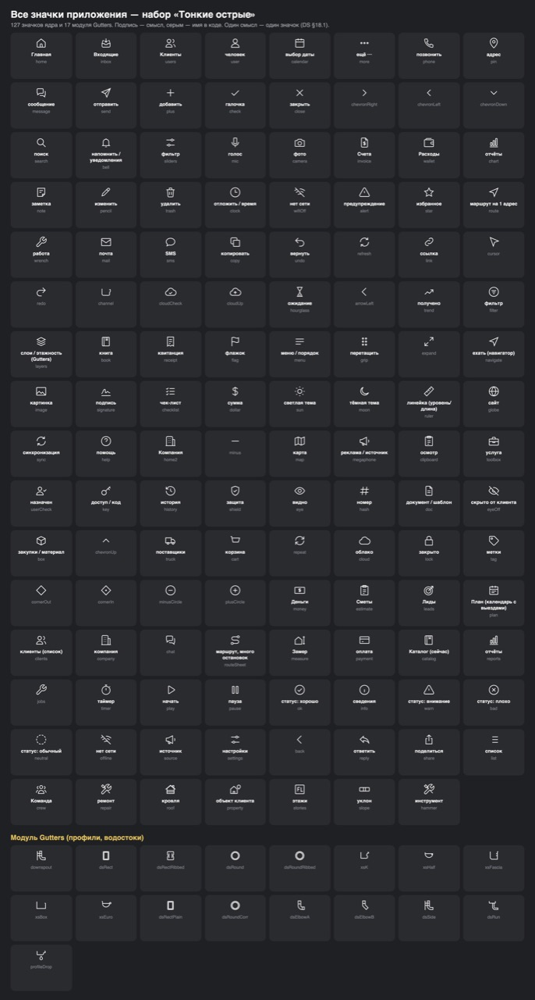
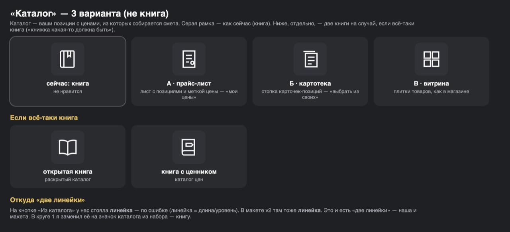
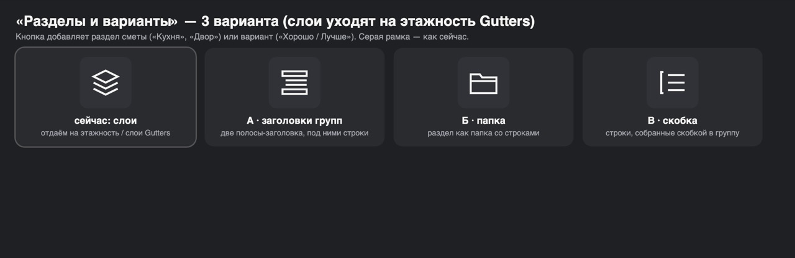
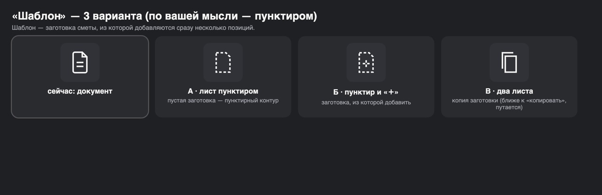
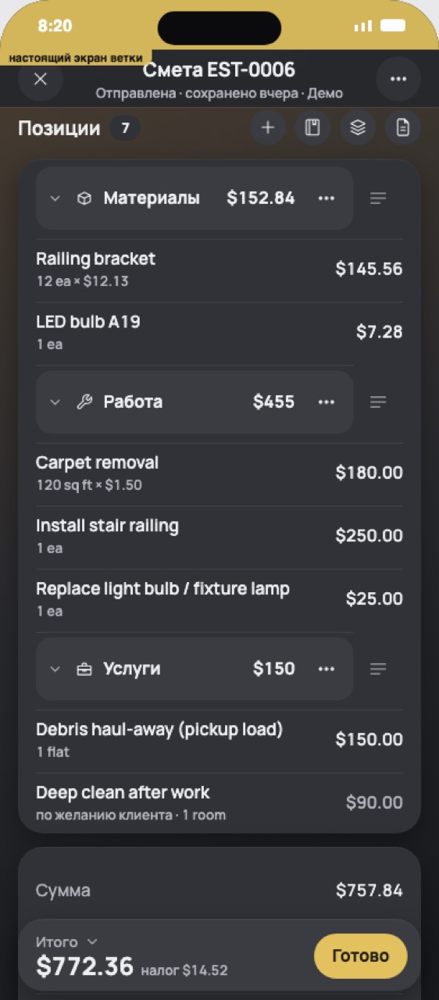
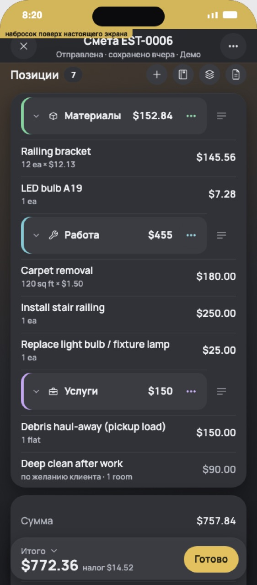

# Документ дизайнера №2 — значки и цвет групп (21.11.2026, #2363)

Уже отвечено и не повторяется: 71–79, «Итого» (сделан вариант А кодом), N1.

## Значки · весь набор — Весь набор приложения: смысл → значок

Все значки ядра и модуля Gutters одной таблицей, подпись — смысл, серым — имя в коде. Правило: один смысл — один значок.

**Посмотреть, нет ли значка, смысл которого непонятен без подписи; такие — отдельным списком на переделку.**

**ВОПРОС:** Какие значки в наборе вам не нравятся или непонятны?

## Значок «Каталог» — А прайс-лист · Б картотека · В витрина (+ две книги отдельно)

Три варианта не-книги; ниже — две книги на случай, если всё-таки книга (вы говорили «книжка какая-то должна быть»). Там же — откуда «две линейки»: линейка стояла и у нас, и в макете.

**Совет: А «прайс-лист» — каталог это ваши цены, лист с меткой цены читается сразу и не путается с «Документом» и «Шаблоном». Если хочется книгу — «книга с ценником».**

**ВОПРОС:** Каталог: А, Б, В — или книга (открытая / с ценником)?

## Значок «Разделы и варианты» — А заголовки групп · Б папка · В скобка

«Слои» отдаём модулю Gutters — на этажность и слои. Для разделов сметы — три новых рисунка.

**Совет: А «заголовки групп» — похоже на то, как раздел выглядит в самой смете (полоса-заголовок и строки под ней).**

**ВОПРОС:** Разделы: А, Б или В?

## Значок «Шаблон» — А лист пунктиром · Б пунктир и «＋» · В два листа

Вам не нравится нынешний «документ»; по вашей мысли — пунктиром (заготовка).

**Совет: А «лист пунктиром» — пунктир сразу говорит «заготовка», не путается с «Копировать» (В похож на него).**

**ВОПРОС:** Шаблон: А, Б или В?

## Цвет групп сметы — А · без цвета (сейчас в коде)

Группа — своя светлая полоса, значок вида, название и сумма.

**Совет: А — группы и так хорошо видны, цвет остаётся только для статусов (правило 2).**

**ВОПРОС:** Цвет групп: А без цвета или Б свой цвет?

## Цвет групп сметы — Б · свой цвет у каждой группы

Работа — синяя кромка, Материалы — зелёная, Услуги — сиреневая. Это ИСКЛЮЧЕНИЕ правила 2 (цвет только для статуса): решает основатель; цвет всегда рядом со словом группы.

**Если Б — записать исключение в CLAUDE.md правило 2 и DS, как у этажей Gutters.**
