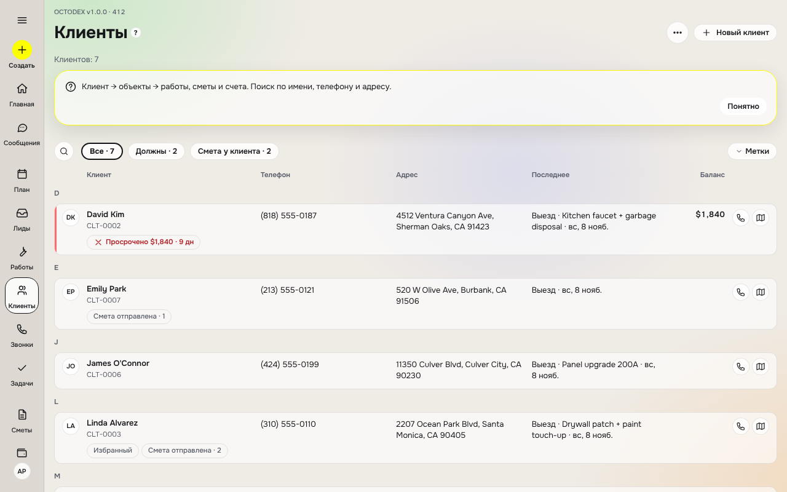
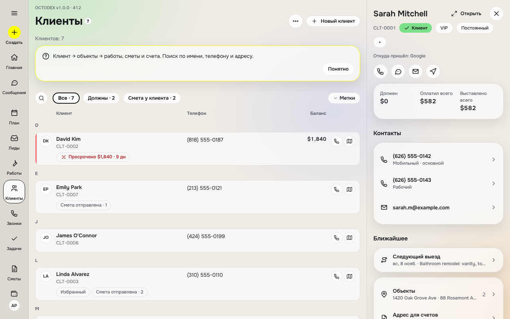
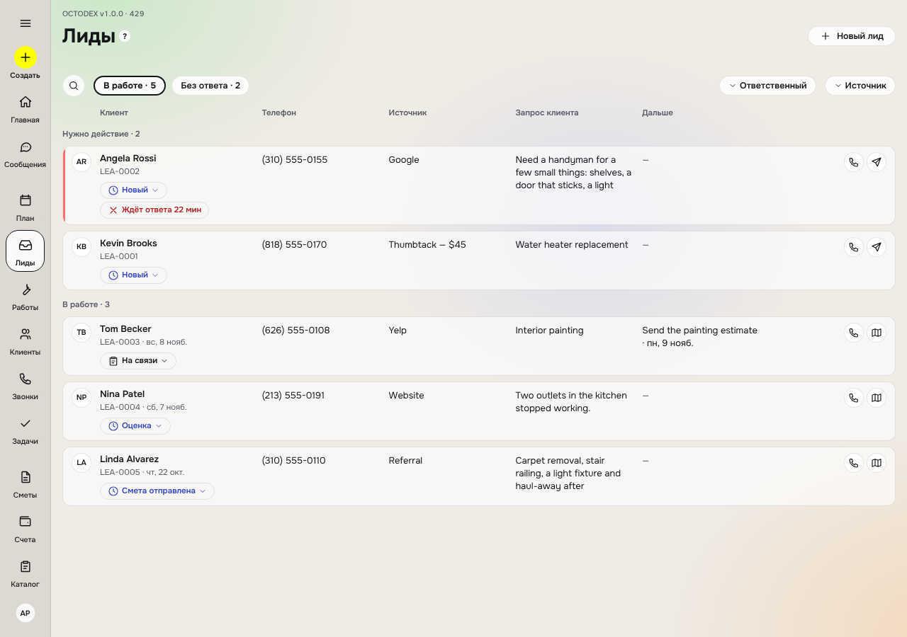
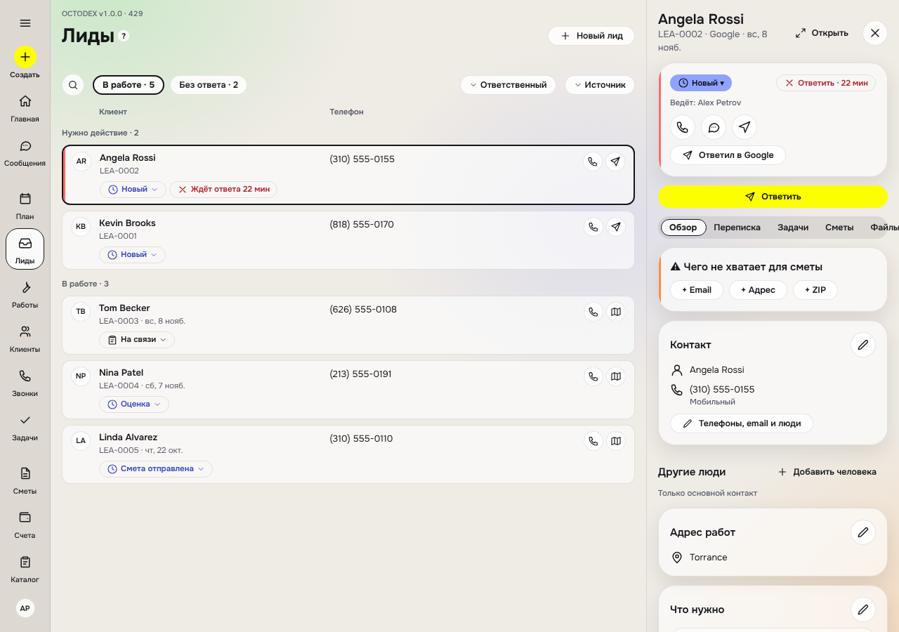

# 06. Карточки списков — единая система

> 05.11.2026. Прототип: `docs/prototypes/list-cards.html` (открывается в браузере; переключатели: устройство 390 / 820 / 1280, тема, плотность, кромка, состояние, роль). Таблица соответствия в прототипе собрана из тех же данных.
> Касается только карточек **в списках**, не экранов объектов. Код карточки (`src/ui/surfaces.tsx`) ведёт чат «dazzling-hamilton»; этот документ — предложение для него.

## Аудит и решения (этап 0 шага 10а, 05.11.2026)

Проверили: дизайнер (токены, контраст, размеры, 390/820/1280 × 2 темы, 20 списков), архитектор (как встроить), хранитель карты (переходы статусов против `15-story-map.md` §4–§5). Основатель добавил: все зоны нажатия и размеры текста — по правилам App Store.

### Что подтвердилось
- Контраст в обеих темах проходит 4.5:1 (минимум 4.79 — текст `bad` на плитке в тёмной теме).
- На 390 / 820 / 1280 нет горизонтальной прокрутки и троеточий.

### Что меняем и почему
| № | Было в прототипе | Решение | Почему |
|---|---|---|---|
| 1 | Три жёлтых элемента на телефоне («＋» в шапке, «＋» в панели, выбранный фильтр) и жёлтая рамка выделения | Жёлтый один — «＋» в нижней панели. «Новый …» в шапке — обычная кнопка `surf2`. Выбранный фильтр — `surf2` + `ink`; выделение строки — рамка `ink` | Правило 2: один акцент |
| 2 | Зона нажатия 40 у кнопок 32 на планшете, 36 у кнопок 28 в «Требует внимания», 32 у чипов отбора | **Зона нажатия ≥ 44×44 pt везде** (App Store / Apple HIG), на Android `hitSlop` до **48×48 dp** (Google Play). Видимые: телефон 36, планшет и компьютер 28/32. Зоны соседних целей не перекрываются: между рядами чипов промежуток `space-2` | App Store, правило 3 |
| 3 | `fs-micro` 10.5 в подписях плиток, «СУММА», шапках колонок | Минимум текста 11 pt (`font.minSize`): подписи плиток и значения — `caption` 11.5. Текст масштабируется системным размером шрифта (Dynamic Type / шрифт Android): карточка растёт, строки переносятся, ничего не обрезается | App Store, правило 6 «Наряда» |
| 4 | Около 15 значений числами (12.5, 15, межстрочные 1.25/1.35/1.4, отступы 2/6, значки 12–14, полоса 6, плитка 78, строка выбора 48) | Новые токены: `lineHeight.snug` 1.35, `size.iconXs` 12, `component.gap.hair` 2 / `tight` 6, `component.rowOption` 48, `component.tileMin` 78; полоса прогресса — существующий `stepBar` 4; кнопка — `font.size.button` 12.5 (есть в TS, добавить `--fs-btn` в CSS). Сначала CSS «Наряда», затем TS, затем `mirror.test.ts` | Правило 1: только токены |
| 5 | Шеврон на каждом чипе | Шеврон только у чипа, который **можно** сменить руками; у остальных чипов его нет, нажатие не делает ничего | Меньше шума и честный признак |
| 6 | Шторка давала выбрать любой статус | Руками — **только существующими функциями стора** и только без ввода: лид `reopenLead`; клиент «в архив» `setCustomerStatus`; задача «готово» `saveTask({doneAt})`. Закрыть лид, «стал клиентом», «не обслуживаем», записать на осмотр — **открывают существующие формы** (нужна причина или дата). Смета, работа, визит, счёт, платёж — чип только для чтения | Карта §4–§5: стор не умеет другие ручные переходы, базу и статусы не меняем |
| 7 | «Без ответа 7 дн», «Просрочен 12 дн», «Срок завтра», «Не дозвонились ×2», «Опаздывает», «Маржа ниже 35%», «Прайс старше 90 дн» как статусы | Это **вычисляемые признаки**, а не статусы: показываются вторым чипом рядом со статусом, в базе не хранятся. Список — в `15-story-map.md` §5 отдельной строкой (решение руководителя), каждый — модульный тест | Правило 14: статусы только из §5 |
| 8 | Метка направления на всех карточках и её смена | У лида, сметы, работы поля направления **нет** (есть только `Company.trades`). В PR1–PR7 метка показывается только у каталога и только если у компании больше одного направления; на лидах, сметах, работах — после решения руководителя о поле `trade` и стыке «лид → смета → работа наследует направление» | Новое поле = миграция и общие файлы |
| 9 | Карточка — `div role=button` с кнопками внутри | В RN: карточка — `Pressable` «открыть», кнопки связи — отдельные цели; у карточки `accessibilityActions` (позвонить, SMS, карта) для экранного диктора | Доступность: нет вложенных кнопок для VoiceOver |
| 10 | Недоступные статусы в шторке затемнены (контраст 2.5–3.4) | Без затемнения: значок замка и подпись «ставится сам» обычным `mut` | Контраст 4.5:1 |
| 11 | Чип статуса в строке 1280 шире колонки | Чип переносится внутри ячейки; колонка статуса — по содержимому, текст фактов переносится по словам, не по буквам | Перекрытие соседней колонки |
| 12 | Значки фактов без слов | Оставляем (решение основателя). Подпись факта — в `accessibilityLabel` и в подсказке при долгом нажатии | Телефон без наведения |

### Брейншторм: что упрощает жизнь подрядчику с телефона
- **Звонок, SMS, маршрут с карточки** без открытия — главное ускорение; оставляем на всех карточках с контактом.
- **Подробная карточка** длинная (лид 230–330 px, на экране 1,5 карточки). Основатель выбрал «крупнее, но всё видно». Компромисс: в группе «Готово» и в уведомлениях — «обычная» (до 4 строк), в остальных — «подробная». Переключатель размера остаётся в настройках списка.
- **Цвет суммы** (просрочено, маржа) всегда со значком ▲ / ✕ рядом, а не только цветом.
- Списки без сущностей в модели (договоры, абонементы, расходы со статусами, заказы поставщикам, поставщики, субподрядчики, команда со статусами) — рецепты готовы, экраны появятся вместе с сущностями своих шагов.

### Как карточка влияет на данные
`ListCard` сама ничего не меняет. Единственные пути: проп `onContact` (кнопка связи отдаётся экрану, экран записывает её существующей функцией стора и сам открывает ссылку через `openContact`) и `status.onPress` (экран открывает `StatusPicker` с переходами из `statusMoves`). Для лида `onContact` повторяет `ContactActions` страницы лида: звонок по открытому лиду → «Дозвонились?» (`callResult`), SMS / email → `touchLead`; e2e 30 сверяет записи в базе с записями со страницы лида.

### Счета и расходы (PR5)
- **Статус счёта — только из `src/features/invoiceStatus.ts`** (`invoiceStatusView`): «Ждёт оплаты» / «Оплачен частично» / «Оплачено»; баланс через движок (`clientMoney`), переплата и нулевая сумма — «Оплачено». Списки и экран счёта берут чип отсюда, свои названия не вводятся.
- Признаки «Просрочен N дн» / «Срок сегодня / завтра» — `invoiceSigns`; кромка только у них.
- Расходы: категория — первая серая метка, «Без чека» — серая метка (не статус: у расхода нет статуса в §5); группы по месяцам (en-US); у карточки расхода нет нажатия и кнопок связи — экрана расхода пока нет.

### Каталог (PR6)
- **Исключение к §7.6** (решение руководителя 05.11): в каталоге мастер видит **цену продажи** (она нужна для сметы на месте), но **никогда** — себестоимость и маржу. В остальных списках мастер сумм не видит.
- Плитки «Себестоимость» и «Маржа» — всегда обе, «—» если данных нет (ровные ряды). Считает только `catalogItemEconomics(item, catalog)` из `features/estimateDoc.ts` (чат смет, #98; движок внутри). Цена ниже себестоимости — знак «В убытке» (bad), кромка и маржа с минусом; мастер их не видит (e2e 33).
- Цена ниже себестоимости — признак `bad` «В убытке» (порог не нужен). «Маржа ниже нормы» не делаем — нет настройки компании.
- Каталог не очередь: на планшете и компьютере — сетка карточек (`CardGrid`), не строки; группы по типу только при отборе «Все».
- **Полей нет (позже):** склад (остаток), направление бизнеса позиции, категория (сейчас её заменяет тип), артикул.

### План PR (шаг 10а; порядок изменён руководителем 05.11: лиды сразу после клиентов)
| PR | Что | Файлы | Тесты |
|---|---|---|---|
| 1 (#73) | Карточка, значки, токены, без смены экранов | `src/ui/listCard.tsx`, `src/ui/listCardLayout.ts`, `src/features/statusMoves.ts`, `src/features/listSigns.ts`, `packages/design-tokens`, `design/naryad-ds/tokens/*.css`, блок `card.*` в `src/i18n/*` | `listCardLayout`, `statusMoves`, `listSigns`, `mirror` |
| 2 (#82) | Клиенты | `(tabs)/clients.tsx`; `CardGrid`; сторож выравнивания `e2e/cardsAlignment.cjs` и его список в `08-layouts` | e2e `29-client-list-cards`; `10`, `14`, `21`, `24`, `28`, `08` зелёные |
| 3 (#86) | Лиды | `features/lead/LeadParts.tsx`, `(tabs)/inbox.tsx` (список); подпись чипа «Сменить статус: …» | e2e `30`; `04`, `15`, `19` зелёные |
| 4 (#91) | Сметы (список) | `EstimatesBoard` в `features/boards.tsx`, `estimates.tsx` | e2e `31`; `01`, `18`, `25` зелёные |
| 5 (#95) | Счета и оплаты | `InvoicesBoard`, `money.tsx` | e2e `32`; `03` зелёный |
| 6 (#102) | Каталог | `catalog/index.tsx` (шторки выбора позиции не трогаем) | e2e `33`; `01`, `04`, `27` зелёные |
| 7 (#106) | «Требует внимания» | `(tabs)/triage.tsx`, `today.tsx`; `attention.ts` только читаем | e2e `34`; `11`, `23` зелёные |
| — | Панель открытой карточки на 1280 (с чатом навигации) | вид панели; `?open=`, ↑/↓, Esc — чат навигации | — |

Каждый PR добавляет свой экран в `CARD_SCREENS` спеки `08-layouts`: края карточек на линии поиска, ряды планшета одной высоты, равные промежутки.
Старый `ItemCard` остаётся, пока не переведён последний экран; затем удаляется отдельным PR.

### Итог шага 10а (05.11.2026)
**Сделано (всё в `main`).**
- Одна карточка списков `ListCard` (`src/ui/listCard.tsx`) и её правила (`src/ui/listCardLayout.ts`): один порядок фактов, короткие факты парами, без «…» (до 3 строк на факт), только значки без слов, кнопки связи всегда «позвонить, SMS, карта, письмо». Ссылки связи — из общего `src/features/contactLinks.ts`: номер и адрес почты из веб-формы в ссылку не попадают как есть.
- Плотности `compact | regular | rich | row`; на 1280 — строка-карточка с колонками; на 820 и для каталога на 1280 — ровная сетка `CardGrid`.
- Зоны нажатия: iOS 44, Android 48 (`touchPad`, токен `size.hitMinAndroid`); текст не мельче 11.
- Статус и направление работ (trade) на карточке — нажимаемые чипы с выбором (`StatusPicker`); ручные переходы только из `statusMoves.ts`, системные статусы вручную не меняются.
- Вычисляемые признаки (`listSigns.ts`: «без ответа N дн», «просрочен N дн» и т. п.) внесены в `15-story-map.md` §5 как вычисляемые, с модульными тестами.
- Цветная кромка — только warn / bad (`edgeTone`).
- Переведены списки: клиенты (#82), лиды (#86), сметы (#91), счета и расходы (#95; статус счёта — только из `invoiceStatus.ts`), «Выезды» мастера (#100), каталог (#102), «Требует внимания» (#106: одна карточка на человека со всеми причинами, `attentionPeople.ts`; на «Сегодня» до 3 людей).
- Проверки: модульные `listCardLayout`, `statusMoves`, `listSigns`, `listGroups`, `invoiceStatus`, `attentionPeople`, `contactLinks`; e2e `29`–`34`, `39` на 6 видах; сторож выравнивания `e2e/cardsAlignment.cjs` (`CARD_SCREENS` в `08-layouts`).

**Исключения (решено).**
- Каталог: мастер видит цену позиции, но не себестоимость и маржу (§7.6).
- Расходы: карточка без перехода (экрана расхода нет), не тускнеет.
- Шторки выбора (клиент, позиция, мастер) — строками, не карточками (правило 12 `CLAUDE.md`).

**Осталось.**
1. ~~Каталог: заглушка `catalogEconomicsStub.ts`~~ — сделано: `catalogItemEconomics` из `estimateDoc`, заглушка удалена, e2e 33 «В убытке».
2. В каталоге нет полей «остаток», «направление», «категория», SKU — нужна модель данных (отдельный шаг, не 10а).
3. ~~Ещё на старом `ItemCard`: работы, команда, уведомления, «Бригады сейчас», списки показателей~~ — на `ListCard`. Лента «Плана» — на `ListCard` (PR A2, 08.11, «Карточки» №4). `ItemCard` остался в экранах объектов — серия B1…Bn.
4. Панель открытой карточки на 1280 (`?open=`, ↑/↓, Esc) — вместе с чатом навигации.
5. Предложения правил из аудита `docs/audit/unslop-2026-11-05.md` §4 ждут решения основателя и руководителя; до решения новых сторожей нет.

### Продолжение 10а: оставшиеся списки (план руководителя 05.11)
| PR | Что | Тесты |
|---|---|---|
| 8 (#108) | «Работы»: клиент, работа, адрес, телефон, ближайший выезд, все назначенные (`assigneesOf`), номер сметы, направление; сумма только офису | `jobList`, e2e `44` |
| 9 (#115) | «Уведомления» на «Сегодня»: событие — карточка, «Запланировать работу» внутри; мастер не видит | e2e `45` |
| 9b | «Команда» — только карточка списка (шторка «Сотрудник» — чат смет, #98) | e2e `50` |
| 10a | «Бригады сейчас» на «Сегодня» | `crewList`, e2e `46` |
| 10b | Списки цифр «Сегодня» (`figures/[metric]`) на общих карточках | e2e (следующий свободный номер) |
Выезды в «Плане»: вид ленты сохранён, убрана кромка ok / info (PR A, 07.11); перевод на `ListCard` — отложен до после 10в.

### PR9b «Команда» (этап 0, 05.11; вариант B — решение руководителя)
- **Было:** `ItemCard`, подзаголовок через «·» (роли · субподрядчик · email/телефон); «Приглашён» — жёлтый чип (по §5 — neutral); «Вы» — зелёный чип (цвет не для статуса); связи нет.
- **Стало:** `ListCard` на человека: инициалы (у субподрядчика пунктир), имя; роли, «Субподрядчик», «Вы» — серые метки; телефон, email; позвонить / SMS (на своей карточке нет). У мастера «сегодня» как в «Бригадах сейчас»: «Выездов сегодня: N», чип — статус текущего выезда, иначе следующего (только чтение), факт «Сейчас» — клиент и адрес. «Приглашён» — neutral. Кромки нет: в команде нечего «делать». Телефон — одной колонкой, планшет и десктоп — сеткой (`CardGrid`).
- **Нажатие:** как было — директор открывает «Сотрудник» у сотрудника; субподрядчик и чужие роли — не открывается.
- **Нерешённое (нужна модель данных):** «часы», «не на связи», «выходной», «на смене» из §5 — данных нет.

### PR10a «Бригады сейчас» (этап 0, 05.11)
- **Было:** `ItemCard` — имя, «N выездов», чип текущего выезда или «Свободен»; не видно, где мастер и что дальше; связи нет; нажимается только при активном выезде.
- **Стало:** `ListCard` на мастера, одной колонкой (как «Требует внимания» рядом). Инициалы (у субподрядчика пунктир), имя, «Выездов сегодня: N». Чип — статус текущего выезда, иначе следующего, иначе «Свободен»; только для чтения (шаги выезда меняются на экране выезда). Факты: «Сейчас» — клиент и адрес текущего выезда; «Дальше» — время и клиент следующего; телефон мастера. Кнопки: позвонить, SMS (адрес мастера — не место назначения). Без цветной кромки.
- **Переход:** текущий выезд, если его нет — «План».
- **Кто на выезде:** `todayVisits` → `isAssigned` (все назначенные, #105); текущий и следующий — `crewNow` (`src/features/crewList.ts`).

### PR10b «Цифры „Сегодня“» (этап 0, 05.11)
- **Было:** четыре вида `ItemCard` через «·» (лиды, сметы, оплаты, счета); те же объекты в основных списках уже на `ListCard`, здесь выглядят по-другому.
- **Стало:** одна карточка на объект везде — карточки лида, сметы и счёта выносятся из `LeadParts.tsx` и `boards.tsx` в общие компоненты без смены вида; оплата — новая карточка (клиент, номер квитанции, способ, дата, сумма «+» зелёным) → квитанция. Проверка: сумма на карточке = сумма той же записи в основном списке.
- **Найдено:** итоги «Ждёт оплаты» и «Подписано» в `features/metrics.ts` считаются не так, как в списках (`invoiceBalance`, `estimateListAmount`) — передано чату «Лиды и клиенты» отдельным PR.

## 00. Правила раскладки (одни для всех карточек; главнее порядка строк в §0, §3, §5)
1. **Шапка:** ведущий элемент · имя (о ком или о чём) и под ним «когда» · справа сумма или время с подписью; если суммы нет, справа «когда».
2. **Чипы:** статус (цветной) → направление бизнеса → прочие метки (серые).
3. **Строки — всегда в этом порядке** (пустые пропускаются), список задаёт только *какие* строки показывать, но не их порядок:
   1. кто и как связаться — номер документа и телефон (парой), клиент, email, адрес;
   2. что — источник, запрос клиента, работа, тип объекта, состав заказа, описание;
   3. когда — расписание, дата, дальше, срок, действует до, получение;
   4. кто делает — ответственный, кто, где сейчас, часы;
   5. связи и прочее — связанные документы, поставщик, склад, оплата, чек, условия, прайс, лицензия, страховка, доступ, история, заметка.
4. **Цифры** плитками, затем прогресс.
5. **Кнопки:** позвонить, SMS, карта, email — всегда в этом порядке, если есть контакт; справа одно главное действие.

**Статус и направление меняются с карточки.** Нажатие на чип статуса или метку направления открывает выбор (шторка на телефоне, окно на планшете и компьютере), строки 48. Смена — тост «Отменить» 5 с. Статусы, которые ставит само приложение (просрочка, «без ответа N дн», «в пути», «оплачен частично», «открыта N раз», маржа ниже нормы), в выборе видны, но недоступны с пометкой «ставится сам». Список направлений берётся из «Настроек компании». Переход статуса руками — та же функция стора, что и автоматический (правило стыков `15-story-map.md` §4), с модульным тестом на запрет ручной установки «авто»-статусов.

## 0a. Версия 3 (05.11.2026, по отзыву основателя)
- **Без слов-подписей у фактов** («Адрес:», «Email:», «Номер:», «Откуда:» убраны). Остаётся только значок; подпись читает экранный диктор и показывает подсказка при наведении. Поэтому у каждого факта в одном списке **свой, не повторяющийся значок**.
- Новые значки (в дизайн-систему): `map` — карта и маршрут (отличается от `send` «отправить / напомнить»), `megaphone` — источник лида, `clipboard` — запрос клиента («что нужно»), `toolbox` — работа и направление, `userCheck` — ответственный, `key` — доступ на объект, `history` — история и последнее событие, `shield` — страховка, `eye` — кто видит заметку, `hash` — номер документа.
- **Источник лида:** «Google LSA — $32.00» (без «лид стоил»).
- **Направление бизнеса** — первая серая метка (значок `toolbox` + «Кровля и водостоки», «Электрика»…) на лидах, сметах, договорах, работах, визитах, абонементах, счетах, заказах поставщикам и позициях каталога. Список направлений компания задаёт при регистрации (`Company.trades`); если направление одно — метка не показывается.
- **«Когда»** («2 ч назад», «вчера», «с Nov 2026») — справа от имени, если справа нет суммы.

## 0. Версия 2 (05.11.2026, по отзыву основателя) — заменяет §2 и плотность по умолчанию в §4–§5
- **Подробная карточка по умолчанию** почти во всех списках (уведомления — обычная). Лучше крупнее, но без лишнего открытия.
- **Без троеточий.** Каждый факт — своя строка (значок 16 + серая подпись + текст), переносится, **не больше 3 строк**; длиннее — последняя строка мягко гаснет, полный текст в открытой карточке.
- **Короткие факты парами.** Факты постоянной длины — номер документа (EST-0145), телефон, дата, срок, остаток на складе — ставятся по два в строку без подписи (только значок), если оба ≤ 20 знаков на телефоне (≤ 30 на планшете и компьютере).
- **Шапка:** ведущий элемент · имя (переносится) и строка «когда» под ним · справа сумма/время с подписью («к оплате», «договор»). Номер документа уходит в факты.
- **Кнопки связи** на каждой карточке с контактом: позвонить, SMS, карта и маршрут, email (круглые 36, зона 44); справа одно главное действие текстом. Жёлтая кнопка на экране одна — «＋».
- **Цифры плитками:** счета и договоры — сумма / выставлено / оплачено / осталось; каталог — себестоимость (с налогом при покупке) / цена / маржа (ниже нормы компании 35% → `warn`); поставщики и субподрядчики — открыто / за год; абонементы — в год / визитов.
- **Метки без цвета:** направление бизнеса, тип позиции (услуга / работа / субподряд / товар), «2 объекта».
- **Факты по спискам** (порядок строк): лид — номер, откуда (и цена лида), что нужно, адрес, телефон, email, ответственный, заметка; смета — номер, адрес, работа, действует до, ответственный, телефон; договор — работа, адрес, связано (смета, счета, работа), когда, плитки денег; клиент — номер, адрес (и другие объекты), телефон, email, откуда, последнее событие, плитки «работ / оплатил»; объект — клиент, телефон, тип дома, доступ (код ворот, собака), история работ; работа — номер, что, адрес, когда (явно: «Начало», «Отменена», «Дата не назначена»), ответственный, связано; визит — время и вид, адрес, мастер, работа или лид, телефон, заметка; каталог — артикул, склад, поставщик и закупка, описание мелким, плитки маржи; поставщик — контакт, телефон, email, филиал, условия, дата прайса; заказ — работа, получение, состав, номер у поставщика; команда — где сейчас, что дальше, телефон, часы; субподрядчик — контакт, лицензия, страховка, наряды.
- **Компьютер:** строка-карточка с переносом текста, статус под именем, справа «позвонить» и «карта»; при открытой карточке справа — одна колонка фактов.

## 1. Главное правило
Любой объект любого списка — одна `ItemCard` (правило 12). Своих компонентов на вкладку не делаем: у карточки **один порядок мест** и **пять рецептов**. Новый список выбирает рецепт и добавляет строку в таблицу §5.

## 2. Места в карточке (слева направо, сверху вниз)
| № | Место | Вид | Правило |
|---|---|---|---|
| 1 | Кромка | 3 px слева | только тон `warn` / `bad` (решение §7.3) |
| 2 | Ведущий элемент | 36 (компакт 28) | инициалы, значок документа, блок даты/времени, галочка; без цвета, кроме сигналов |
| 3 | Заголовок | heading 15/600, 1 строка | о ком или о чём (клиент, поставщик, позиция), не номер |
| 4 | Строка деталей | body 13, `mut`, части через « · » | в порядке колонок списка; обрезается первой |
| 5 | Значение справа | heading 15/600, tabular | сумма / время / длительность; не обрезается; у мастера сумм нет |
| 6 | Статус-чип | caption 11.5, значок + слово | третьей строкой под деталями, слева; не обрезается |
| 7 | Подвал | только «подробная» | прогресс оплаты или одна строка + одна кнопка 28 (не `acc`) |

Порядок обрезки на 390: хвост деталей → детали целиком → заголовок многоточием. Значение и чип не обрезаются.

## 3. Рецепты
| Рецепт | Слева | Списки |
|---|---|---|
| A. Человек / организация | инициалы (пунктир — потенциальный, приглашён) | клиенты, лиды, поставщики, команда, субподрядчики, объекты (значок дома) |
| B. Документ с деньгами | значок типа документа или способа оплаты | сметы, договоры, счета, платежи, расходы, заказы поставщикам, абонементы |
| C. Время | блок `11:30 / AM` или `NOV / 9` | визиты (календарь), работы |
| D. Позиция | значок категории | каталог, строки прайса, сборки |
| E. Сигнал | значок причины в цвете статуса / галочка | требует внимания, уведомления, задачи, заметки |

## 4. Плотность и ширины
- **Компактная** (44–52): шторки выбора, «Другое у этого клиента», каталог. Заголовок 13, чип мягкий под заголовком.
- **Обычная** (76–84): все списки на телефоне и планшете.
- **Подробная** (до 120): где нужно решение — «Требует внимания», лиды.
- **Телефон 390**: одна колонка; свайп вправо — прямое действие, влево — отложить; каждое действие свайпа есть и в открытой карточке.
- **Планшет 820**: две колонки той же карточки, заголовки групп на всю ширину.
- **Компьютер 1280**: меню разделов **сверху пилюлей**, как во всём приложении; бокового меню нет (решение основателя 05.11.2026, `docs/specs/10-nav-wide.md`). Список · открытая карточка справа (`panel-w` 360) с «Другое у этого клиента» — отдельным PR после «Клиентов», вместе с чатом навигации (адрес `?open=`, ↑/↓, Esc — у него; вид панели — здесь; соседей даёт функция из `src/nav/`). Над строками — подписи колонок (`ListCardHeader`). Карточка рисуется **строкой-карточкой** 44: места → колонки, каждая строка — своя поверхность (правило 12 соблюдено). Сортировка по колонкам, выбор нескольких галочками. При открытой панели в строке одна колонка деталей.

## 5. Списки
| Список | Рецепт | Заголовок | Детали | Справа | Статусы (тон) | Плотность | Свайп → / ← | Группы |
|---|---|---|---|---|---|---|---|---|
| Лиды | A | имя | источник · услуга · когда | смета | новый (info), ответ просрочен (bad), не дозвонились (warn), осмотр (info), смета отправлена (info), стал клиентом (ok), потерян (neutral) | подробная | позвонить / отложить | по статусу |
| Сметы | B | клиент | EST · дата · объект | сумма | без ответа N дн (warn), отказ (bad), черновик (neutral), отправлена / открыта N раз (info), одобрена (ok) | обычная | напомнить / копия | по статусу |
| Договоры | B | клиент | CTR · что · отправлен | сумма | ждёт вашей подписи / клиента (warn), отменён в срок отказа (bad), срок отказа ещё N дн (info), подписан (ok) | обычная | напомнить / PDF | по статусу |
| Клиенты | A | имя | адрес или «N объекта» · телефон | должен | просрочено (bad), потенциальный (neutral); у остальных чипа нет | обычная | позвонить / SMS | алфавит |
| Объекты | A | адрес | город · клиент | — | открытая работа (info), гарантия до … (ok) | обычная | маршрут / заметка | — |
| Работы | C | клиент | JOB · что · кто | договор | ждёт даты, ждёт материал (warn), в работе, запланирована (info), готова (ok), отменена (neutral) | обычная | назначить / перенести | по статусу |
| Визиты | C | клиент | вид · адрес · мастер | длительность | опаздывает (warn: «Опаздывает · в пути» / «· не выехал», П3c), накладка (warn, вторая метка; `overlapSigns`), не подтвердил (warn), в пути, окно (info), подтвердил, завершён (ok) | обычная | маршрут / позвонить | по дню |
| Абонементы | B | клиент | план · как часто · следующий | цена / период | платёж просрочен (bad), продление через N дн (warn), активен (ok), пауза (neutral) | обычная | визит / пауза | по статусу |
| Задачи | E | текст | к чему · кому | срок | просрочена (bad), сегодня (warn), позже (neutral), готово (ok) | обычная | готово / завтра | по статусу |
| Счета | B | клиент | INV · за что · срок | к оплате | просрочен N дн (bad), срок завтра (warn), черновик (neutral), частично, отправлен (info), оплачен (ok) | обычная (подвал — прогресс) | напомнить / оплата | по статусу |
| Платежи | B | клиент | RCT · способ · счёт | ±сумма | отклонено (bad), возврат (warn), в обработке (info), получено (ok) | обычная | квитанция / возврат | по дате |
| Расходы | B | где | категория · работа · дата | −сумма | статусов нет; «без чека» — серая метка (решение PR5) | обычная | чек / к работе | по статусу |
| Каталог | D | позиция | ед. · откуда · «тестовая цена» | цена / ед. | нет у поставщика (warn), в архиве (neutral) | компактная | в смету / копия | по типу |
| Поставщики | A | компания | что берём · контакт | открыто | прайс старше 90 дн (warn), ждём поставку, запрос цены (info) | обычная | позвонить / email | — |
| Заказы поставщикам | B | поставщик | PO · работа · получение | сумма | устарел, получено частично (warn), черновик (neutral), отправлен, подтверждён (info), получен (ok) | обычная | получено / повторить | по статусу |
| Команда | A | имя | роль · сегодня | часы | не на связи (warn), в пути (info), на объекте, на смене (ok), выходной, приглашён (neutral) | обычная | позвонить / SMS | — |
| Субподрядчики | A | компания | направление · лицензия | за год | страховка истекла (bad), истекает (warn), допущен (ok) | обычная | позвонить / наряд | — |
| Требует внимания | E | что случилось | кто · документ | сумма | срочно (bad), внимание (warn) | подробная; вид «Люди» по умолчанию | сделано / завтра | по клиенту |
| Уведомления | E | событие | подробности · когда | — | новое (info, точка у заголовка) | обычная | прочитано / скрыть | по дню |
| Заметки | E | первая строка | к чему · автор · дата | — | закреплена, только мне (neutral) | обычная | закрепить / удалить | — |

## 6. Обвязка любого списка (сверху вниз)
1. Шапка: заголовок, «?», «Выбрать», «＋» — единственная `acc`-кнопка. Переключателя подсписков нет: Лиды, Сметы, Счета — отдельные разделы (решение основателя 07.11, спека 31 §7а).
2. «Без сети · N в очереди»; у карточки в очереди в деталях — «Не отправлено».
3. Поиск: имя, телефон, адрес, номер (EST, INV, RCT, JOB, PO, CLT, LEA).
4. Фильтры — по спеке 31: ряд «поиск + Фильтр», одна лента статусов с числами без переноса — первым широкий охват по умолчанию, дальше по ходу работы, «Все» последним (решение руководителя 07.11); нули скрыты.
5. Итог денежного списка (рецепт B), прилипает: «Показано N · сумма», отдельно «Проблемы $…». По текущему отбору, только через `@octo/estimating-engine`.
6. Группы: документы — «Нужно действие → Черновики → Ждём → Готово»; визиты, платежи, уведомления — по дню; клиенты — по алфавиту; в заголовке группы число или сумма.
7. Состояния: скелет той же высоты; «пусто вообще» (с главным действием) и «ничего по отбору» («Сбросить отбор») — разные тексты; «Нет доступа» для роли.
8. Выбор нескольких → «Выбрано N · действие всем», тост «Отменить» 5 с.

## 7. Решения основателю
1. Компьютер — строки-карточки 44 вместо больших карточек.
2. Заголовок — клиент, номер документа — в деталях.
3. Цветная кромка только у warn / bad.
4. Свайп — ускоритель; в «Внимании» и лидах кнопка видна в подвале.
5. «Требует внимания» по умолчанию «Люди» (одна карточка на клиента со всеми причинами).
6. Мастер не видит сумм ни в одном списке; денежные списки закрыты «Нет доступа».
7. Вычисляемые статусы («без ответа 7 дн», «просрочен 12 дн», «продление через 14 дн») вносятся в `15-story-map.md` §5 как вычисляемые, с модульными тестами.

## 8. Что сделать в коде после согласования
- `ItemCard`: места `meta[]`, `value`, `chip`, `footer`, `density` (`compact | regular | rich | row`); рецепты A–E в `src/ui/listCards.tsx`; строка-карточка для 1280.
- Токены: высоты плотностей, кромка уже есть (`component.statusEdge`); новые значки (`repeat`, `box`, `truck`, `doc`, `cart`, `cloud`, `lock`, `sort`, `tag`) — в дизайн-систему.
- Тесты: сторож дизайна проверяет, что списки используют `CardList` + рецепт; e2e на 6 видах для каждой плотности; модульные — порядок отбора и групп, вычисляемые статусы.

## 10а, остаток: «План» на ListCard, удаление ItemCard, панель 1280 (этап 0, 07.11.2026, «Карточки списков» №3)

**Проверка сделанного** (`PLANNING.md` шаг 1а, решение основателя 07.11):
| Вопрос | Ответ | Доказательство |
|---|---|---|
| Сделано ли уже? | экраны-списки — да, кроме «Плана»; «План» на `ItemCard` (`PlanParts.tsx`, 5 мест); `ItemCard` ещё в ~50 местах экранов объектов; панели 1280 нет (ни одного `?open=`); открытых PR по «Плану» и карточкам нет (open 07.11: #259, #263, #289–#297) | grep `ItemCard`; `src/nav/*` |
| Так ли, как в плане и спеке? | нет: в «Плане» зелёная и синяя кромка у ok / info (06 §7.3 — только warn / bad), заголовок «время · клиент» (06 §5 — клиент; время — блок слева), адрес и номер обрезаются «…» (06 §0 — без «…») | снимок `plan-before-390` (артефакт «Карточки Плана») |
| По указаниям основателя? | 06 §7 (решения 1–7) и «крупнее, но всё видно» — его; по «Плану» — «пусть дизайнер решает» (LOG «Решения», спека 24 §C); 24 §B — имя не режется. Отдельного указания о карточке «Плана» нет | `docs/ai/LOG.md`, спека 24 |
| Что сломается? | **вид ленты «Плана», который основатель видел**: на телефоне 1–2 выезда на экран вместо 6 (полная карточка) — нужен его выбор по картинке «до / после» (А полная / Б компактная / оставить); тексты e2e 09, 67, 68, 108 (поправлены); «Неделя» и «Месяц» — те же карточки; «День» по людям не меняется | артефакт «Карточки Плана»; e2e 130 |

**Клетка.** План §0 строка 10а (◐): «выезды „Плана“ на ListCard, удалить ItemCard, панель 1280». Карта: шаг 10а — вид, без новых стыков и статусов; признаки «опаздывает», «накладка» уже в §5 (вычисляемые).
**Опоры.** Эта спека §0–§5, §7; `docs/specs/10-nav-wide.md` §1.5 (панель, `?open=`, ↑/↓, Esc); `docs/specs/24` §B (лента «Плана»); `CLAUDE.md` правила 1–3, 12; «Наряд» (`design/naryad-ds`); прототип `docs/prototypes/list-cards.html`; памятка «Карточки» №2 (BOARD).

### Оспаривание
| № | Утверждение | Откуда | Ответ | Почему (доказательство) | Что меняем и где |
|---|---|---|---|---|---|
| 1 | Карточка списка — `ItemCard` | `CLAUDE.md` правило 12 | опровергаем | карточка списков — `ListCard` (`src/ui/listCard.tsx`, 23 файла); `ItemCard` — старая обёртка `Card`+`ListRow` (`surfaces.tsx:201`) | новый текст правила 12 — руководителю |
| 2 | «Любой объект — одна `ItemCard`»; места `meta[]`, `chip`, `footer` у `ItemCard` | §1, §8 | опровергаем | сделано в `ListCard` (`facts`, `status`, `signs`, `action`, `density`) | §1, §8 — читать как `ListCard` (правка текста в PR удаления) |
| 3 | На `ItemCard` ещё работы, уведомления, «Бригады сейчас», цифры «Сегодня» | «Осталось» п.3 | опровергаем | `jobs.tsx`, `notices.tsx`, `today.tsx`, `figures/[metric].tsx` — на `ListCard` (grep) | из экранов-списков остался только «План» |
| 4 | Выезды «Плана» переводит «Лиды и клиенты» (П3b) | §«Продолжение» | опровергаем | руководитель 07.11 отдал задачу этому чату | строка устарела |
| 5 | `ItemCard` осталась в `plan.tsx` (WeekView), `PlanParts`, `ContractStatement`, `ServiceCategoryPicker` | памятка №2 | опровергаем | `plan.tsx` чист; `ItemCard` — ~55 мест в 15 файлах: `PlanParts` (5), экраны объектов `client/[id]`, `lead/[id]`, `lead/new`, `job/[id]`, `invoice/[id]`, `property/[id]`, `ClientSections` (10), `PropertySections` (12), `LeadParts` (2), `client/import`, `money`, `triage`, `boards`, `ContractStatement`, `ServiceCategoryPicker` | удаление — серия PR (ниже) |
| 6 | Спека — «только списки, не экраны объектов»; `ItemCard` удаляется после последнего экрана-списка | шапка, §«План PR» | оспариваем | в экранах объектов `ItemCard` рисует и **списки связанных объектов** (сметы, работы, счета клиента — правило 12 их касается, §4 «компактная: Другое у этого клиента»), и **одиночные подсказки** («Возможный дубль», «Не обслуживаем», «Должен $…») — это не списки | вариант ниже; решает руководитель |
| 7 | Цветная кромка только `warn` / `bad` | §7.3 | подтверждаем правило; код нарушает | `Card` рисует кромку у любого не-`neutral` (`surfaces.tsx:90`): в «Плане» зелёная и синяя кромки у выездов и готовых задач; `ListCard` — `edgeTone` | «План» на `ListCard`; e2e 130 проверяет |
| 8 | Визит: рецепт C (блок времени слева), заголовок — клиент | §3, §5 | подтверждаем | так «Выезды» мастера (#100, `(tabs)/visits.tsx`); в «Плане» сейчас «время · клиент» в заголовке | рецепт C |
| 9 | Визит: справа — длительность | §5 | оспариваем | начало и конец уже в блоке времени и «когда» — повтор. Рекомендация: справа «к оплате», если есть сумма у выезда (как у мастера), офису; иначе пусто | технический — руководитель |
| 10 | Визит: «опаздывает» warn, «накладка» второй меткой, детали — вид, адрес, мастер | §5, карта §5 | подтверждаем | `visitStatus`, `overlapSigns` (`listSigns.ts`) | факты: адрес, работа, кто назначен, номер работы |
| 11 | Имя не режется: на телефоне признаки уходят в подпись | 24 §B | опровергаем средство, цель подтверждаем | `ListCard` переносит имя и рисует признаки отдельными чипами без «…» (`listCardLayout`) — обходной путь не нужен | признаки — `signs` на всех ширинах |
| 12 | У задач — рецепт E; у событий и выходных рецепта нет | §3, §5 | оспариваем | в «Плане» есть события и выходные; рецепт E со значком, статус `neutral`, без кромки — без новой сущности | §5: строка «События плана» |
| 13 | Мастер не видит сумм | §7.6 | подтверждаем | «Ждут даты» и «Не назначено» — только у планирующих (`plan.tsx:95–108`); у мастера `value` не ставим | e2e 130 у мастера |
| 14 | Свайп вправо / влево на телефоне | §4 | оспариваем | в `ListCard` свайпа нет ни в одном списке; не в задаче | отдельно, если основатель подтвердит |
| 15 | Панель 1280: вид — здесь; `?open=`, ↑/↓, Esc — чат навигации; первым — «Клиенты» | §4, 10-nav-wide §1.5 | подтверждаем раздел; оспариваем срок | в коде нет ни одного `?open=`; нужна цепочка `src/nav/hierarchy.ts` («Каркас» №8) и `clients.tsx` («Лиды и клиенты»). На телефоне подрядчику ничего не даёт | отдельным этапом 0 после удаления `ItemCard` |
| 16 | Зона нажатия 44 / 48, кнопки 28/32/36 | правило 3, §0 п.2 | подтверждаем | `ListCard` `touchPad`, `size.hitMinAndroid` | — |

Итог: подтверждено 6, опровергнуто 6, оспорено 4.

### Решение (предложение)
- **PR A — «План» на `ListCard`** (предложение этапа 0; руководитель 07.11 выбрал узкий вариант — см. «PR A — сделано») (`PlanParts.tsx`): выезд — рецепт C (время слева, клиент, «когда» с концом, чип статуса только для чтения, признаки, факты адрес / работа / кто / номер, связь — позвонить клиенту и маршрут); задача — рецепт E (`neutral` / `ok`, без кромки); событие и выходной — рецепт E; «Ждут даты» — действие «Запланировать», сумма только планирующим; «Не назначено» — признак `warn`, действие «Назначить». «План» — в `CARD_SCREENS` спеки `08-layouts`. e2e 130 на 6 видах; поправить тексты в e2e 09, 67, 108, 109.
- **PR B1…Bn — удаление `ItemCard`**: списки связанных объектов в экранах объектов → `ListCard density="compact"`; одиночные подсказки → `Card` + `ListRow` (не список, правило 12 не нарушается). По одному PR на группу файлов (как экраны-списки), файлы — на время у этого чата. Последний PR удаляет `ItemCard` и ставит сторож «нет `ItemCard`» в `designSystem.test.ts`.
- **PR C — панель 1280** — отдельный этап 0 с «Каркасом».

### Решения руководителя (07.11)
- Правило 12 — новый текст («`ListCard` в `CardList` / `CardGrid` из `src/ui/listCard.tsx`») вносит руководитель.
- В1 (п.6) — да: серия B1…Bn по группам файлов; перед группой — сообщение владельцу («Лиды» №10, за «Сметы» — руководитель); последний PR удаляет `ItemCard` и ставит сторож.
- В2 (п.9) — справа у выезда «к оплате» только офису (`canPlan`) и только если сумма есть; иначе пусто.
- В3 (п.15) — панель 1280 отдельным этапом 0 после удаления `ItemCard`.

### PR A — сделано (узко, решение руководителя 07.11)
- Основатель поручил выбор руководителю; выбран вариант «оставить ленту как есть, убрать кромку ok / info»: «План» — обзор дня, его вид одобрен (24 §B, #267); полная карточка оставляет 1–2 выезда на экран (снимки — артефакт «Карточки Плана»).
- `ItemCard` (`ui/surfaces.tsx`) красит кромку только у warn / bad; у ok / info статус говорит чип. Это касается всех мест, где ещё стоит `ItemCard` (лента «Плана», «Ждут даты», «Не назначено», списки в экранах объектов). Сам `Card` (экраны объектов: квитанция, подписанная смета, `/p/`) не менялся — его вид основатель видел.
- e2e 130 (6 видов): у «на месте» (info) и «готово» (ok) кромки нет, у «не назначен» (warn) есть — в ленте и в «Не назначено»; без правки падал.
- **Отложено, вернуться после 10в:** рецепты C / E для «Плана» на `ListCard` (выезд — время слева, клиент, факты, связь; задача и событие — рецепт E). Код готов в ветке `claude/cards3-plan-listcard` (не вливать без решения); полная карточка — 1–2 выезда на экран, компактная — без адреса и мастера.

### PR A2 — «План» на `ListCard` (08.11.2026, «Карточки списков» №4)
Задание руководителя №5: выезды «Плана» на `ListCard`, рецепты C / E. Код — ветка №3 `claude/cards3-plan-listcard`, перенесённая на main #381 (после 10в: фильтры #339, «Назначить» вторичной #343).
- **Почему №3 отложил:** полная карточка давала 1–2 выезда на экран телефона вместо 8 — «План» терял обзор дня. **Решение (мелкое, исполнитель — правило 07.11):** в ленте на телефоне и планшете у выезда только то, что §5 требует от визита: время слева, клиент, «когда», статус и метки, **адрес и кто**; номер работы, работа и кнопки связи — на 1280 (строка-карточка с колонками адрес · работа · кто) и на экране выезда. Итог — ~4 выезда на экран телефона. Сравнивались: полная карточка (2 на экран), компактная (`compact` — без адреса и мастера, теряет «где и кто»), выбранная (4 на экран).
- Задача, событие, выходной — рецепт E (имя, время слева, статус-чип, «кто»); «Ждут даты» — сумма только планирующим, действие «Запланировать»; «Не назначено» — статус warn с кромкой, действие «Назначить».
- e2e 130 переписан под `ListCard` (тот же сценарий кромки + рецепт C, «к оплате» офису, мастер без сумм, связь только на 1280, выравнивание); надписи поправлены в e2e 09, 67, 68, 108, 109 (их проверки «нет …» по старой надписи «время · клиент» стали бы слепыми).
- Снимки было / стало — в PR.

## Серия B: снять `ItemCard` с экранов объектов (08.11.2026, «Карточки списков» №5)

Правило (п.6 и В1 этапа 0 выше): **список связанных объектов** → `ListCard density="compact"` в `CardGrid` (телефон — 1 колонка, 820 — 2, 1280 — 3); **одиночная подсказка** → `Card` + `ListRow` (это не список, правило 12 не нарушается).

Компактная карточка: значок типа слева (28), заголовок — о чём (работа, смета, счёт), под ним **одна строка деталей** через « · » (номер, адрес, дата), справа сумма (у мастера сумм нет), чип статуса мягкий под заголовком. Правка `ListCard`: в компактной строка `when` всегда под заголовком (раньше без суммы уходила вправо и сжимала заголовок); компактных карточек до B1 не было.

| PR | Файлы | Списки → `ListCard` compact | Подсказки → `Card`+`ListRow` |
|---|---|---|---|
| B1 | `client/[id]`, `ClientSections`, `client/import` | объекты, работы, лиды, сметы, счета, квитанции, задачи (рецепт E: галочка слева закрывает / возвращает задачу, «Отменить» в тосте), история; пропущенные строки импорта (дубль — серый, ошибка — кромка warn) | «Следующий выезд», «Открытых задач», «Не оплачено $…» (кромка warn), «Фото с выездов» |
| B2 | `property/[id]`, `PropertySections` | «Сейчас на объекте»: работы, сметы; разделы объекта: лиды, работы, сметы, счета, выезды, фото, история; люди объекта — `regular` (роль, телефон, кнопки «Позвонить» / «SMS» карточки) | «Следующий визит» |
| B3 | `lead/[id]`, `lead/new`, `LeadParts` (`TasksBlock` — общий для лида и объекта) | найденные по телефону/email клиенты и лиды («Не обслуживаем» — значок bad и чип; «Уже ваш клиент», «Возможный дубль» — значок warn, кромка warn, «⚠» из текста убран); «Недавнее»; выезды лида (как в B2; без мастера — значок и кромка warn); сметы лида (сумма только `canSeeClientMoney`, у мастера нет); задачи (рецепт E, подписи `task.done`/`task.undo`, просрочка — знак bad «Просрочено»); люди лида — `regular` (роль, телефоны, email; без кнопок связи — звонок лиду идёт через «Позвонить» с вопросом «дозвонились?», Р13) | «Следующий шаг» |
| B4 | `job/[id]`, `invoice/[id]`, `money`, `triage`, `ContractStatement`, `ServiceCategoryPicker`; удалить `ItemCard`, сторож в `designSystem.test.ts` | работа: выезды (дата · время, мастер · длительность, чип статуса), расходы (сумма справа), счета мастера (к оплате), история (как в B1); счёт: квитанции (способ оплаты, номер · дата · ссылка, сумма ok); выписка договора: счета (за что, номер · срок · оплачено частично, сумма, чип); настройки → направления: список направлений компании (это экран-список, не меню выбора в шторке), архивные — с действием «Вернуть»; если имя снова занято, действия нет, а в строке деталей «Такое направление уже есть» (кнопку карточки нельзя выключить) | — (в `money` и `triage` `ItemCard` только импортировался) |

B1, было / стало: `docs/specs/img/06-b1-*-before-after.png` (слева было, справа стало). Тесты: e2e 21 (задача закрывается и возвращается галочкой), 70 (карточки работ и лидов ищутся по `testID` `client-job-<id>`, `client-lead-<id>`), 27, 74, 75 — 6 видов.

B2, было / стало: `docs/specs/img/06-b2-*-before-after.png`. Тесты: e2e 73 (работа ищется по `testID` `property-job-<id>`; мастер — нет сумм в работах объекта), 27, 85, 146 — 6 видов.

B3, было / стало: `docs/specs/img/06-b3-*-before-after.png`. Оспаривание (5): подтверждено 4 (правило серии; `TasksBlock` общий для лида и объекта — меняется один раз; рецепт E как в B1; `ListCard` уже даёт значок, знаки и кромку — правок `listCard.tsx` нет), опровергнуто 1 («в лиде только вид»: у мастера во вкладке «Сметы» своего лида была видна сумма сметы — теперь нет). Статусы смет лида — общая таблица `estView` (как у клиента и объекта; отклонённая — bad). `testID` задач — `<subjectType>-task-<id>` (лид / объект). Тесты: e2e 127 (мастер — у сметы лида нет суммы, директор — есть), 15 (задача: галочка, «Отменить» в тосте, возврат галочкой), 74 (карточка «Не обслуживаем» в лиде открывает клиента), 122 (дубль нового лида по `testID` `new-lead-dup-*`), 15, 19, 22, 24, 40, 73, 74, 90, 131 — 6 видов.

B4, было / стало: `docs/specs/img/06-b4-*-before-after.png`. `ItemCard` удалён из `src/ui/surfaces.tsx`; сторож «нет `ItemCard` в `src`» — `apps/mobile/test/designSystem.test.ts`. Шторка выбора направления (`ServiceCategoryRow` → `Sheet`) осталась строками `ListRow` — меню выбора, правило 12. Тесты: e2e 37 (архивное направление: пока имя занято — нет «Вернуть» и строка «Такое направление уже есть»; дубль в архив — «Вернуть» снова есть), 63 (мастер: у счёта своей работы — остаток к оплате, не итог), 02, 03 (выписка договора и квитанции счёта), 05, 62, 65, 79, 80, 81, 83, 99, 105, 107, 121 — 6 видов.

## 10а, панель 1280 (этап 0, 08.11.2026, «Карточки списков» №7)
**Клетка.** План §0 строка 10а (остаток «панель 1280»); 10-nav-wide §1.5 и Н5. Карта: вид и навигация, без новых стыков и статусов.

**Что делаем.** На компьютере (≥ 1280) нажатие на строку списка открывает карточку справа панелью `panelW` 360, список остаётся. Адрес `/<список>?open=<id>`; ↓/↑ — соседняя строка, Esc и «✕» — закрыть; «⤢ Открыть» — карточка на весь экран. На 390/820 — как было: новый экран; ссылка с `?open=` на узком окне ведёт на экран карточки.

**Варианты.** А (взят) — панель внутри экрана-списка (`Screen aside`), тело карточки — общий компонент экрана и панели. Б — вложенный маршрут карточки внутри списка: expo-router этого не даёт без ломки стека, BackSwipe и tabBarRule. В — шторка-маршрут справа: плохо с клавишами и `?open=`.

**Оспаривание.**
| # | Утверждение | Откуда | Итог | Доказательство |
|---|---|---|---|---|
| 1 | Панель только на 1280; 820 — сетка, нажатие — экран | 10-nav-wide §1.5, здесь §4 | подтверждаем | на 820 сетка в 2 колонки, места под 360 нет |
| 2 | «Назад» в браузере работает с `?open=` | 10-nav-wide §1.5 | оспариваем | если каждое ↑/↓ — запись в истории, «назад» листает карточки по одной. Открыть, ↑/↓, Esc — замена адреса (`setParams`); «назад» уводит с экрана списка (e2e 155) |
| 3 | Цепочка при открытой панели `⌂ › Клиенты › Имя`, «Клиенты» закрывает | 10-nav-wide §1.5 | опровергаем для вкладочных списков | «Клиенты» — корень-вкладка, цепочки на нём нет (13а §3, e2e 28); закрывают «✕» и Esc. Цепочка остаётся у экрана карточки |
| 4 | Звено «Клиенты» с экрана карточки ведёт на `/clients` | 10-nav-wide §1.5 | уточняем | goTo возвращает к живому экрану списка с его `?open=`: из карточки, открытой из панели, назад — в список с той же открытой панелью (e2e 28, 36) |
| 5 | В панели «Другое у этого клиента» | здесь §4 | подтверждаем | тело карточки уже даёт строки работ, смет, счетов с числами — это и есть соседи |
| 6 | При открытой панели в строке одна колонка деталей | здесь §4 | подтверждаем | `COLUMNS_PANEL` = телефон |
| 7 | «⤢ Открыть» или двойное нажатие — карточка на весь экран | 10-nav-wide §1.5 | опровергаем двойное нажатие | первое нажатие уже открыло панель, второе по той же строке ничего не добавляет, а на сенсорном экране 1280 двойное нажатие неочевидно; «⤢ Открыть» — рядом в шапке панели |

**Права.** Панель рисует то же тело, что экран (`ClientCardBody`): мастер не видит денег и в панели (e2e 155, роль tech).

**Устройство.** `src/nav/listPanelRule.ts` — чистые `neighbor`, `panelId`, `panelKey` (unit `test/listPanel.test.ts`); `src/nav/listPanel.ts` — хук `usePanelKeys` (веб; молчит, когда фокус в поле или открыта шторка — Esc сначала закрывает её) и `focusSelectedRow` (перед «Открыть» фокус на выбранную строку, назад — на неё, Н3а). `src/ui/listPanel.tsx` — панель; `Screen aside`; `ListCard aria-current` (у кнопки нет `aria-selected` по ARIA). ↑/↓ работают, только когда фокус на строках списка или нигде — не в прокрутке панели, не в фильтрах и меню; Esc — везде, кроме поля и открытой шторки. Ссылка с `?open=` на узком окне — экран карточки один раз при заходе, список под ним без `?open=` (поворот планшета только прячет панель). Открытая карточка выпала из фильтра (действие в панели: подписали, оплатили; или ссылка на закрытую) — панель **остаётся**: это карточка, с которой работают (ревью #426); `?open=` снимается, только если карточки для этого человека нет. ↓/↑ от неё — к первой строке списка.

**Порядок.** PR 1 — «Клиенты» (e2e 155). PR 2 — «Сметы» и «Счета» (e2e 156). «Лиды» (e2e 157) — следующему чату.

**Было / стало (1280).**   — тёмная: `img/06-panel-*-dark.png`.

**PR 2 — «Сметы» и «Счета» (#425 → этот PR).** Общий хук `useListPanel(ids, href, known)` в `src/nav/listPanel.ts` (открыть/закрыть/«Открыть», клавиши, ссылка на узком окне, выпадение из фильтра) — «Клиенты» переведены на него. Тела карточек: `features/EstimateCard.tsx` (`EstimateCardBody`, весь экран сметы без шапки; `?send=1` → `openSend`), `features/invoice/InvoiceCard.tsx` (`InvoiceCardBody`). Строки: `EstimateListCard`/`InvoiceListCard` получают `panel` (выбрана, открыть, узко); при открытой панели одна колонка — «Работа» у сметы, «Срок» у счёта. Список счетов хранит `?f=`, `?customer=` вместе с `?open=`. Под заголовком панели — клиент и адрес, как на экране. Мастер: маржи нет и в панели (e2e 156); список счетов мастеру закрыт, как был. Снимки: `img/06-panel-estimates-*`, `img/06-panel-invoice-*`.

**Долги.** ↓/↑ не прокручивают список к выбранной строке, если она ушла за край; на открытой панели «＋» карточки клиента нет (есть на её экране).

## 10а, панель 1280 — «Лиды» (этап 0, 08.11.2026, «Карточки списков» №8)
**Что делаем.** «Лиды» на 1280 открывают карточку лида справа панелью, как «Клиенты» и «Сметы»: `useListPanel` + `ListPanel` + `LeadListCard panel`. Тело `lead/[id]` переносится в `features/lead/LeadCard.tsx` (`LeadCardBody`) без изменения вида; экран лида рисует то же тело. Под заголовком панели — та же строка, что под заголовком экрана: номер · источник · цена (только `canSeeLeadCost`) · дата. При открытой панели в строке одна колонка — «Телефон». 390/820 — как было.

**Оспаривание.**
| # | Утверждение | Откуда | Итог | Доказательство |
|---|---|---|---|---|
| 1 | Тело лида выносится без изменения вида | задание | подтверждаем | `Screen` экрана держит только заголовок, подзаголовок и «⋯»; всё остальное — тело |
| 2 | В панели нужна «⋯» экрана | — | опровергаем | «⋯» открывает тот же `StatusSheet`, что чип статуса «▾» в теле; дубль в шапке панели не нужен |
| 3 | Мастер в панели не видит денег | §«Права» выше | подтверждаем | цена лида — `canSeeLeadCost`, суммы смет — `canSeeClientMoney`; e2e 157, роль tech |
| 4 | ↑/↓ — по порядку на экране | правила №7 | подтверждаем | список — две группы («Требуют действия», «В работе»); `ids` = их порядок подряд |
| 5 | Лид выпал из фильтра — панель остаётся | правила №7 | подтверждаем | «Сделать клиентом», «Закрыть», «Отложить» из панели уводят лид из «Открытые» — работа с ним продолжается |
| 6 | «Дозвонились» из строки ведёт на экран лида | leads.tsx | уточняем | на 1280 — та же карточка панелью (`panel.open`), на 390/820 — экран, как было |
| 7 | Вкладка лида (Обзор · Разговор · …) общая для экрана и панели | `octo.leadTab.v2` | подтверждаем | ↓ к соседнему лиду оставляет ту же вкладку — так сравнивают лиды |
| 8 | Адрес корня `/leads?tab=leads` | hierarchy.ts | подтверждаем | `setParams` сохраняет `tab`; старые `?tab=estimates|invoices` уводят, как раньше |

**Файлы.** `app/(tabs)/leads.tsx`, `app/lead/[id].tsx` (только перенос тела), `features/lead/LeadCard.tsx` (новый), `features/listCards.tsx` (`LeadListCard panel`), e2e 157, `version.ts`. Общих файлов и новых строк i18n нет.

**PR — «Лиды».** Снимки 1280:   — тёмная: `img/06-panel-leads-*-dark.png`. Выбор статуса с формой из строки на 1280 тоже открывает панель. Долги: вкладки лида в 360 не помещаются («Файлы» уходит за край, прокрутка вбок) — `Segmented` общий; «возможный дубль» в теле ведёт на экран лида, как связанные объекты у «Клиентов».

## 10а, панель 1280 — долги №7 (этап 0, 08.11.2026, «Карточки списков» №8, PR 2)
**Выбор.** Варианты: А — каталог на панель; Б — «Требует внимания» на панель; В — долги панели №7 (прокрутка ↑/↓, «＋» и «Изменить», отметка выпавшей карточки). **Берём В.** Он чинит все четыре готовых списка с панелью сразу (клиенты, сметы, счета, лиды) и только в файлах панели. А: каталог на 1280 — ровная сетка (§4), карточка каталога — форма правки, панель рядом с сеткой выигрыша не даёт. Б: пункты «Требует внимания» — разные объекты (лид, работа, сбой отправки) с кнопкой действия на самой карточке; у списка нет одного тела для панели, работа идёт кнопкой без открытия карточки.

**Оспаривание.**
| # | Утверждение | Откуда | Итог | Доказательство |
|---|---|---|---|---|
| 1 | ↓/↑ не прокручивают к строке за краем | долги №7 | подтверждаем | `useListPanel` меняет только адрес; строка за краем остаётся невидимой. Решение: после ↓/↑ — `scrollIntoView({ block: "nearest" })` у отмеченной строки (веб) |
| 2 | В панели нет «＋» карточки клиента | долги №7 | подтверждаем | экран клиента: `fab="client"` и «Изменить» в шапке; панель — только «Открыть» и «✕». Решение: место `actions` в шапке `ListPanel`; клиентам — «Изменить» и `Fab placement="header"` с `customerId` |
| 3 | «Изменить» нужно в панелях смет, счетов, лидов | — | опровергаем | на экранах сметы, счёта и лида кнопки «Изменить» в шапке нет, правка внутри тела, а тело в панели то же |
| 4 | Карточка, выпавшая из фильтра, ничем не отмечена | правила №7 | подтверждаем | панель открыта, а в списке нет отмеченной строки — непонятно, где она. Решение: под шапкой панели нейтральная метка «Нет в списке — другой фильтр» (значок + слово, тон neutral) |
| 5 | Жёлтая кнопка на экране одна | §1, правило 2 | подтверждаем | на 1280 «＋» списка в шапке экрана; «＋» панели — тот же `Fab` в виде шапки, не `acc` (проверить на снимке; если `acc` — вид `secondary`) |

**Файлы.** `src/nav/listPanel.ts`, `src/ui/listPanel.tsx`, `app/(tabs)/clients.tsx` (действия панели), остальные три списка — флаг «нет в списке», `src/i18n/*` — одна строка с префиксом `card.panel.`, e2e 158, `version.ts`.

**PR 2 — сделано.** ↓/↑ прокручивают к отмеченной строке (`scrollSelectedRow`). «Изменить» и «＋» в панели клиента стоят отдельной строкой под заголовком: рядом с заголовком в 360 им нет места, имя сжималось до нуля (e2e 155). Метка «Нет в списке — другой фильтр» — у всех четырёх панелей. Вкладки лида на телефоне и в панели прокручиваются вбок (`Segmented scroll`, только там, где не влезают; на 820 и на экране 1280 — как было); e2e 158 падал до правки на 390 у лида со сметами. Снимки: `img/06-lead-tabs-390-before-*`, `img/06-lead-tabs-390-after-*`, `img/06-panel-outside-*`, `img/06-panel-lead-tabs-*`.
