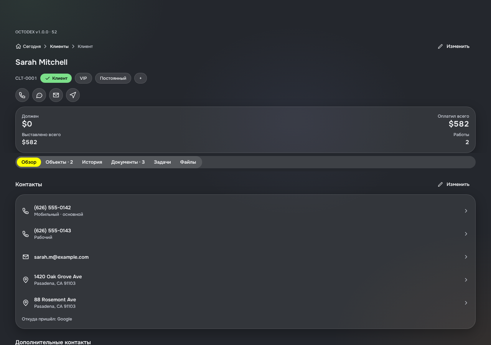
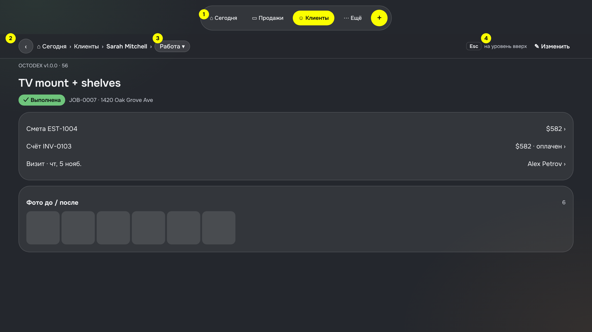
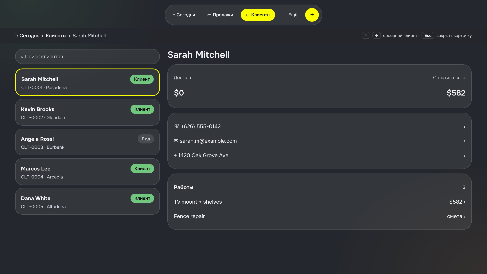
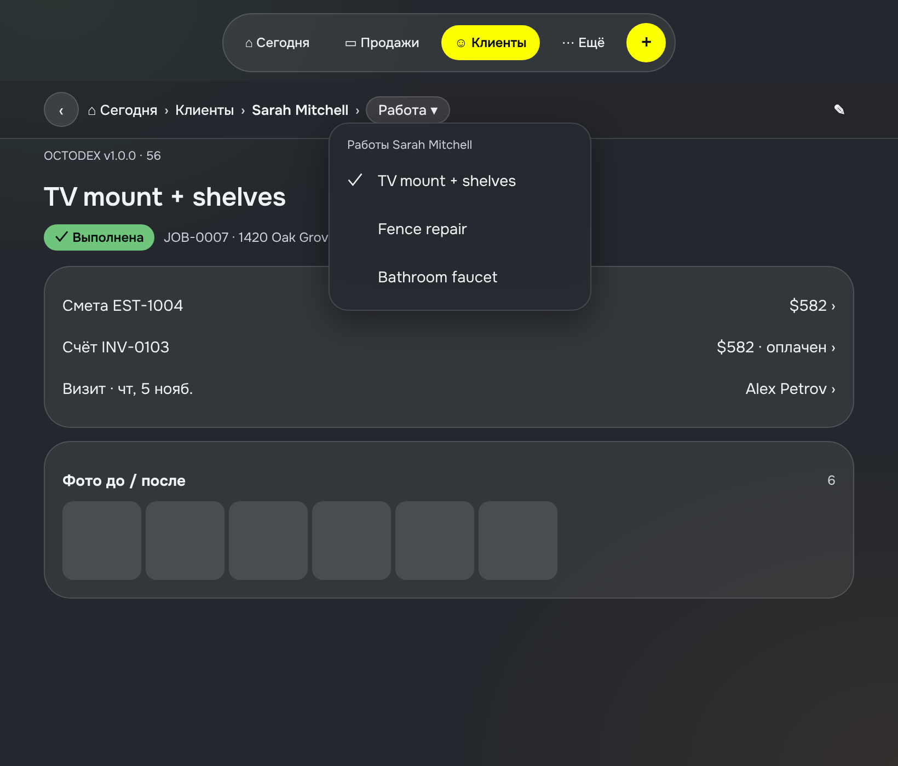
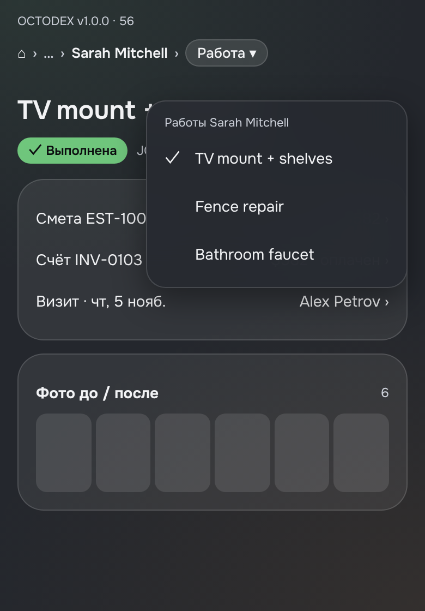

# 10. Навигация на планшете и компьютере

> Просьба основателя 05.11.2026 после шапки-«адреса» (`09-breadcrumbs.md`, сборка 55): «для десктопной и планшетной версии нужно это продумать». На телефоне назад — смахивание. На планшете с клавиатурой и на компьютере смахивания часто нет. Здесь варианты и рекомендация; основатель выбирает, потом руководитель ставит задачу на сборку.

## 0. Как сейчас (сборка 55)

Что мешает:
1. **Верхнее меню вкладок пропадает.** На «Сегодня» вверху пилюля «Сегодня · Продажи · Клиенты · Ещё». Открыл клиента — её нет. Чтобы перейти из карточки клиента в «Продажи», надо сначала нажать ⌂.
2. **Нет «назад» без смахивания.** На компьютере остаётся только звено-родитель в цепочке или кнопка браузера.
3. **Цепочка уезжает при прокрутке.** На длинной карточке, чтобы перейти выше, надо сначала прокрутить наверх.
4. **Карточка растянута на 1200 точек.** Строка телефона клиента — через весь экран, справа пусто. Это решает раскладка списков 06 (панель справа), см. 1.5.

## 1. Варианты по каждому вопросу

### 1.1. Верхнее меню вкладок
| Вариант | Итог |
|---|---|
| А. Как сейчас: на внутренних экранах меню нет | нет: пункт 1 выше |
| **Б. Меню вкладок всегда видно на планшете и компьютере; подсвечена вкладка раздела** (карточка клиента → «Клиенты», смета → «Продажи») | **да** |
| В. Боковое меню слева вместо пилюли (так в 06 §4 на 1280) | нет: в приложении сейчас пилюля, на 1280 боковое меню (≈ 200) + список + панель 360 оставляют строкам меньше 700. Основатель выбрал пилюлю сверху (§3); правило Н1 «меню видно на внутренних экранах» верно при любом выборе |

На телефоне — без изменений: нижняя пилюля прячется на внутренних экранах, как в iOS.

### 1.2. «Назад»
| Вариант | Итог |
|---|---|
| А. Только звено-родитель в цепочке | мало: неочевидно, куда нажать |
| **Б. Круглая кнопка «‹» перед цепочкой на планшете и компьютере** (видимая 32, зона 44) | **да** |
| В. Вернуть «‹ Клиенты» отдельной строкой | нет: дублирует цепочку |

«‹» ведёт на уровень вверх, как звено-родитель. На телефоне кнопки нет — смахивание.

### 1.3. Клавиши (только компьютер)
| Клавиша | Что делает |
|---|---|
| **Esc** | на уровень вверх; если открыта шторка или меню — сначала закрывает её |
| **↑ / ↓** | в режиме «список + карточка» (1.5) — соседний элемент списка |

Больше клавиш не вводим, пока нет поиска (M3 в плане). Подсказка «Esc на уровень вверх» — серым справа в строке цепочки, только на компьютере.

### 1.4. Где цепочка
| Вариант | Итог |
|---|---|
| А. Над заголовком, уезжает при прокрутке (как сейчас) | на телефоне да, на широком — нет |
| **Б. Строка-адрес под меню вкладок, прилипает к верху при прокрутке; справа — действия экрана («Изменить»)** | **да, планшет и компьютер** |

1 — меню вкладок видно всегда, подсвечен раздел. 2 — «‹» на уровень вверх. 3 — последнее звено «Работа ▾» открывает соседей (1.6). 4 — подсказка Esc и действия экрана.

### 1.5. Список и открытая карточка рядом (компьютер)
Раскладку списка на компьютере задаёт `docs/specs/06-list-cards.md` §4 (чат «Дизайн системы карточек списков»): **список строками-карточками 44** с сортировкой по колонкам и **открытая карточка — панель справа** шириной `panel-w` 360 с блоком «Другое у этого клиента». Здесь — только навигация вокруг этой раскладки: адрес, «назад», клавиши.

1 — список строками-карточками (раскладка 06). Выбранная строка — рамка `ink`, не жёлтая (06, решение 1: один акцент). 2 — панель открытой карточки; «⤢ Открыть» — карточка на весь экран. 3 — «Другое у этого клиента» (06): те же соседи, что меню «▾» в 1.6. 4 — клавиши.

| Действие | Что происходит | Адрес |
|---|---|---|
| Нажал строку | справа панель этого клиента, список на месте | `/clients?open=<id>` |
| ↑ / ↓ | соседняя строка, панель меняется | `/clients?open=<id>` |
| Esc | панель закрывается | `/clients` |
| «⤢ Открыть» или двойное нажатие | карточка на весь экран, цепочка `⌂ › Клиенты › Клиент` | `/client/<id>` |
| Строка в «Другое у этого клиента» | этот объект на весь экран, цепочка до клиента | `/job/<id>` и т. п. |

Цепочка при открытой панели — `⌂ Сегодня › Клиенты › Sarah Mitchell`. Звено «Клиенты» закрывает панель. Ссылка `/clients?open=<id>` открывается так же, поэтому её можно переслать, а «назад» в браузере работает.

| Где | Итог |
|---|---|
| Компьютер (≥ 1280) | **да** |
| Планшет 820 | нет: по 06 §4 — две колонки обычных карточек, нажатие открывает карточку на весь экран |
| Телефон | нет |

Панель делает чат карточек; навигацию вокруг неё — по одному списку, когда он переводит этот список.

### 1.6. Соседи по нажатию на последнее звено («Работа ▾»)
Последнее звено цепочки — меню с соседями: другие объекты того же родителя. Выбрал — сразу туда, без подъёма вверх. На всех ширинах, на телефоне тоже.

| Экран | Соседи |
|---|---|
| Работа | другие работы этого клиента |
| Смета | другие сметы этого лида или клиента |
| Счёт | другие счета этой работы (этапы оплаты) |
| Квитанция | другие оплаты этого счёта |
| Визит | другие визиты этой работы |
| Объект | другие объекты клиента |

Правило: «▾» показываем, только если соседей от 2 до 15. Один — нечего выбирать; больше 15 — это уже список, идти через родителя. Клиенты и лиды соседей не показывают (их сотни).

### 1.7. Фокус после перехода (Н3а)
**Как сейчас (сборка 80, проверено в браузере на 1280).** После Esc, «‹» или звена цепочки фокус клавиатуры и экранного диктора падает в пустоту (`body`). Первый Tab после этого попадает на первую кнопку в содержимом («Позвонить» в списке клиентов), мимо меню вкладок. Заголовок экрана не помечен как заголовок: диктор не может перейти к нему по заголовкам, и на странице нет ни одного заголовка.

| Вариант | За | Против | Итог |
|---|---|---|---|
| А. Ничего не делать | — | человек с клавиатурой или диктором после каждого шага начинает с нуля | нет |
| Б. Фокус на заголовок нового экрана | просто; диктор сразу читает, где ты | при возврате в список теряется место: был на Sarah, оказался наверху | для перехода **вниз** (открыл карточку) |
| В. При возврате **вверх** фокус на то, с чего ушёл (карточка Sarah в списке), как кнопка «назад» в браузере и закрытие окна | не теряешь место в длинном списке | надо помнить, откуда ушёл | **да**, для перехода вверх |
| Г. Двигать фокус и на телефоне с VoiceOver / TalkBack | то же для незрячих на телефоне | на iOS навигатор уже ставит фокус диктора на новый экран; риск двойного объявления | отдельно, после проверки на живом iPhone (Н3б) |

**Решение.**
1. Заголовок экрана — настоящий заголовок (роль «heading», уровень 1). На всех ширинах; на вид не влияет.
2. Переход **вверх** (Esc, «‹», звено цепочки, смахивание назад на сайте): фокус возвращается на элемент, с которого ушли вниз, если он ещё на экране. Если его нет (удалён, список пересобран) — на заголовок.
3. Переход **вниз** (открыл карточку): фокус на заголовок нового экрана.
4. Только сайт (`Platform.OS === "web"`). Рамка фокуса видна только при работе с клавиатуры (`:focus-visible`), мышью и пальцем ничего не меняется.
5. Где помнить, откуда ушли: маленький модуль `src/nav/focusMemory.ts` (адрес экрана → элемент, который был в фокусе при уходе), без React, с модульным тестом.

**Тесты (Н3а).** Модульный: `focusMemory` (запомнил, отдал один раз, забыл после ухода выше). e2e на 820 и 1280: список клиентов → Tab до карточки клиента → Enter → фокус на заголовке «Sarah Mitchell» → Esc → фокус снова на карточке Sarah; удалённый элемент → фокус на заголовке. На 390: заголовок — heading, остальное без изменений.

## 2. Рекомендация и порядок сборки
| № | Что | Где | Размер |
|---|---|---|---|
| Н1 | Меню вкладок всегда видно, подсвечен раздел | планшет, компьютер | малый |
| Н2 | «‹» перед цепочкой; строка-адрес прилипает к верху | планшет, компьютер | малый |
| Н3 | Esc — на уровень вверх (сначала закрывает шторку) | компьютер | малый |
| Н4 | Соседи «▾» на последнем звене | все ширины | средний |
| Н3а | После Esc и «‹» фокус клавиатуры и диктора — на заголовок нового экрана (сейчас уходит в body) | компьютер | малый; сразу после Н1–Н3 |
| Н5 | Навигация вокруг панели открытой карточки: адрес `?open=`, ↑/↓, Esc | компьютер | средний; вместе с переводом списка на строки-карточки (06) |

Н1–Н3 — одна сборка (**сделано**, этап 0: аудит, архитектор, доступность — пилюля рисуется в закреплённой шапке экрана, а не поверх стека, чтобы на iPad ехать вместе с экраном). Н4 — отдельная. Н5 — по одному списку, вместе с чатом карточек.

## 3. Решения основателя (05.11.2026)
1. Меню вкладок на внутренних экранах планшета и компьютера — **показывать всегда** (Н1).
2. Меню разделов на компьютере — **сверху** (пилюля, как сейчас). Боковое меню из 06 §4 не делаем.
3. Соседи «▾» — **на всех ширинах, включая телефон** (Н4).
4. Панель открытой карточки и её раскладку делает **чат карточек списков** (06), с какого списка начать — решают он и руководитель. Эта спецификация даёт только навигацию вокруг панели (Н5).

## 4. Стык с карточками списков (`06-list-cards.md`)
| Тема | 06 (карточки) | 10 (навигация) | Кто делает |
|---|---|---|---|
| Раскладка 1280: строки-карточки 44, панель 360 | задаёт | не меняет, рисует поверх неё адрес и клавиши | карточки |
| Выбранная строка | рамка `ink` | ↑/↓ двигают выбор | карточки (вид), навигация (клавиши) |
| «Другое у этого клиента» в панели | задаёт вид (компактная плотность) | те же данные, что меню «▾» (1.6): одна чистая функция соседей в `src/nav/` | навигация (функция), карточки (вид) |
| Планшет 820: две колонки | задаёт | панели нет, нажатие — переход | карточки |
| Адрес `?open=<id>`, Esc, цепочка с открытой панелью | — | задаёт | навигация |
| Меню разделов на 1280 | было боковое (§4) | пилюля сверху (1.1) | **решено: сверху** (основатель 05.11); 06 §4 поправить |
| Свайпы на телефоне | вправо — действие, влево — отложить | смахивание от края — назад; свайп по карточке — только внутри списка | карточки; e2e проверяет, что не мешают |

## 5. Тесты (когда дойдёт до сборки)
- Модульный: правило соседей (2–15, кто чей сосед) для каждой строки таблицы 1.6.
- e2e на 6 видах: меню вкладок видно на карточке (820, 1280) и спрятано (390); «‹» и Esc ведут на уровень вверх; Esc сначала закрывает шторку; меню «▾» открывает соседа; панель на 1280 — выбор, ↑/↓, Esc, ссылка `?open=`; «Другое у этого клиента» и «▾» показывают одних и тех же соседей.
